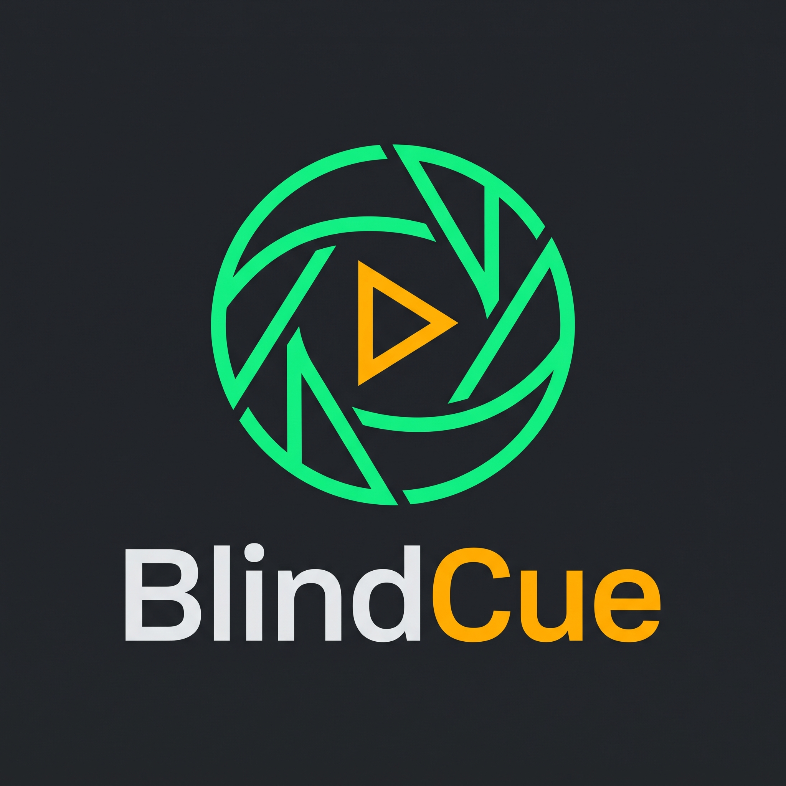

<p align="center">
  
</p>

<h1 align="center">BlindCue</h1>

<p align="center">
  <b>Player di cue audio/video per spettacoli dal vivo, nativo Linux.</b><br>
  Regia e uscita di scena separate, tre layer di proiezione (sei con due proiettori indipendenti), controllo remoto LAN.<br>
  Open source, senza servizi cloud, senza dipendenze proprietarie.
</p>

<p align="center">
  <a href="https://www.python.org/"></a>
  <a href="https://wiki.qt.io/Qt_for_Python"></a>
  
  
  
  <a href="LICENSE"></a>
</p>

---

## Indice

- [Cos'è BlindCue](#cosè-blindcue)
- [Perché esiste](#perché-esiste)
- [Caratteristiche](#caratteristiche)
- [Screenshot](#screenshot)
- [Requisiti](#requisiti)
- [Installazione](#installazione)
- [Avvio rapido](#avvio-rapido)
- [Scorciatoie essenziali](#scorciatoie-essenziali)
- [Struttura del progetto](#struttura-del-progetto)
- [Test](#test)
- [Documentazione](#documentazione)
- [Contribuire](#contribuire)
- [Licenza](#licenza)

---

## Cos'è BlindCue

BlindCue è un **cue player** per teatro, danza, concerti, contest e performance dal vivo. Permette di costruire una scaletta di cue audio, video e immagini, e di eseguirla in scena con comandi a prova di errore.

Il principio è semplice: **il pubblico non deve mai vedere il desktop, una finestra di sistema o una manovra tecnica**. Per questo BlindCue separa fisicamente due ambienti:

| Ambiente | Dove | Cosa mostra |
|---|---|---|
| **Regia** | Monitor primario dell'operatore | Scaletta, ispettore, anteprima, forma d'onda |
| **Uscita** | Proiettore / display di scena (secondo monitor; un terzo monitor per la doppia uscita) | Solo i layer video in onda, a tutto schermo |

---

## Perché esiste

**BlindCue nasce nativo per Linux.** Su Linux mancano strumenti live show validi, leggeri e davvero pensati per il palco: le alternative sono o pesanti, o pensate per altri sistemi operativi, o legate a servizi cloud e licenze.

BlindCue vuole essere l'alternativa che mancava:

- **Linux prima di tutto**: Wayland e X11 nativi, PipeWire/PulseAudio, VA-API per la decodifica video hardware.
- **Leggero**: nessun runtime web dentro l'app, nessun database, nessun servizio esterno. Python + Qt + FFmpeg.
- **Solo open source**: nessuna dipendenza proprietaria, nessuna API a pagamento, nessun account.
- **Usabile anche altrove**: la stessa base gira su **macOS** (Apple Silicon e Intel) e **Windows 10/11**, perché lo spettacolo non sempre si fa sul computer giusto.

---

## Caratteristiche

### Tre layer di proiezione + layer di sicurezza

- **Layer 1** sfondo, **Layer 2** principale, **Layer 3** overlay: indipendenti e sovrapponibili in tempo reale.
- Ogni layer gestisce **video e immagine in modo indipendente**, con **deck A/B** per il cambio di media senza buco nero.
- **Layer 0 (Tappo)**: quando non c'è nulla in onda, il proiettore mostra un reticolo di calibrazione ottica oppure un'immagine di blackout personalizzata.

### Cue e scaletta

- Media **video**, **audio**, **immagini** e **gruppi** (scene).
- Tempi separati: **Pre-Delay**, durata media, **Post-Delay**, hold per le immagini.
- Modalità di avanzamento: **manuale**, **auto-follow**, **simultanea**.
- Gruppi con cinque modalità: **simultaneo**, **sequenziale**, **passo-passo**, **random**, **loop**.
- **Studio Timeline** multi-traccia per comporre visivamente le scene su 3 layer.
- **Sezioni virtuali** (A/B/C…) con loop N volte o vamp infinito, salto e skip.
- **Envelope** di volume e opacità a keyframe, con curve di fade logaritmiche, S-curve o lineari.

### Audio

- Routing separato **Master Sala** e **monitor PFL** in cuffia su dispositivi distinti.
- Analisi **EBU R128** (LUFS integrato e True Peak) per pareggiare il volume tra le tracce.
- Normalizzazione **non distruttiva** e ottimizzazione dinamica con limitazione di picco.
- **Modalità Jam / Contest**: auto-gain su tutte le cue per file non calibrati.

### Video mapping

- **Rilevamento automatico dei proiettori**: BlindCue usa solo gli schermi esterni al monitor di regia. Un proiettore → uscita A; due proiettori → uscita A e B, con scelta esplicita di quale proiettore alimenta ciascuna uscita nel pannello dei layer. Nessun proiettore → uscita in finestra sul monitor di regia, per le prove.
- **Audio multi-scheda**: BlindCue elenca le uscite audio del sistema operativo. Con una sola uscita stereo il monitor cuffia (PFL) viene disattivato; collegando una seconda scheda audio il routing di regia si riattiva.
- **Tre modalità di uscita esplicite**: singolo proiettore, **superficie unica (span)** con due proiettori uniti in un'unica tela continua, oppure **due uscite indipendenti** con tre layer per ciascun proiettore. La modalità è salvata nel progetto e ricordata al riavvio.
- **Assegnazione per uscita**: ogni cue sceglie il proiettore (A o B) e il proprio layer; i conflitti sono calcolati separatamente per le due uscite.
- **Superfici virtuali multiple** con due modalità: rettangolo (split screen, PiP, multi-proiettore) e **quad keystone a 4 punti**.
- **Maschere** rettangolari, ellittiche, forate o da PNG, con feather dei bordi.
- **Soft edge blend** per la sovrapposizione tra proiettori adiacenti.
- **Guide di calibrazione** proiettabili sul palco (reticolo + contorni superfici).

### Controllo remoto

- **Web Remote** mobile-first su LAN: pulsante GO grande, accesso via **QR code**, protezione **PIN** a 6 cifre.
- **Monitor Regista** in sola lettura, per direzione artistica e scena.
- **Server OSC** UDP nativo con comandi `/go`, `/panic`, `/blackout`, `/pause`, `/cue/<id>/go`, `/volume`.
- Tutto **opt-in**: i servizi di rete sono spenti finché non li attivi.

### Resilienza

- Salvataggio **atomico** su file JSON aperto (`.blindcue`).
- **Autosave** ogni 30 secondi e **Crash Recovery** al riavvio.
- **Pausa globale** senza drift e **Panic** a 0 ms.
- **Undo/Redo** fino a 40 passaggi.
- **Budget CPU** dedicato: il lavoro in background non satura mai tutti i core.

---

## Screenshot

<p align="center">
  
</p>

---

## Requisiti

| Componente | Minimo | Note |
|---|---|---|
| **Python** | 3.10 | 3.12+ consigliato |
| **FFmpeg** | qualsiasi build recente | Necessario per waveform, loudness e normalizzazione |
| **RAM** | 4 GB (profilo Eco) | 8 GB+ consigliati per video multipli |
| **GPU** | Qualsiasi con driver aggiornati | VA-API su Linux, VideoToolbox su macOS, D3D11VA su Windows |
| **Display** | 2 schermi consigliati | Il secondo schermo è l'uscita di scena; la doppia uscita indipendente ne richiede un terzo |

L'installer verifica automaticamente Python, RAM, spazio disco, rete, server audio (PipeWire/PulseAudio/ALSA), display (Wayland/X11) e accelerazione GPU.

---

## Installazione

Un solo comando, uguale su tutti e tre i sistemi: `setup.py` riconosce il sistema operativo e delega l'installazione alla cartella giusta (`setup/linux`, `setup/macos`, `setup/windows`).

```bash
git clone https://github.com/diego-costanzo/BlinCUE.git
cd BlinCUE
python3 setup.py            # apre la finestra di installazione
```

La finestra (tema scuro BlindCUE, senza terminale) spiega cosa verrà fatto, mostra l'avanzamento e i controlli in tempo reale, e alla fine offre **Avvia BlindCue**. L'installazione è **per il solo utente e senza password**: nessun `sudo`, nessun UAC.

| Sistema | Dove viene installato | Come si avvia |
|---|---|---|
| **Linux** | `~/.local/share/blindcue` | comando `blindcue`, icona nel menu applicazioni |
| **macOS** | `~/Applications/BlindCue.app` | icona nel Launchpad / Finder |
| **Windows** | `%LOCALAPPDATA%\Programs\BlindCue` | icona sul Desktop e nel menu Start |

Il programma viene **copiato** nella sua cartella definitiva: la cartella del repository scaricato può anche essere cancellata. I tuoi progetti restano dove li hai salvati e l'autosave vive in `~/.config/blindcue`, quindi un aggiornamento non li tocca.

### Opzioni da terminale

```bash
python3 setup.py --terminal    # installazione testuale, senza finestra
python3 setup.py --check       # solo diagnostica, non installa nulla
python3 setup.py --yes         # installazione non interattiva
python3 setup.py --run         # avvia BlindCue se già installato
python3 setup.py --uninstall   # rimuove l'installazione dell'utente
```

### Disinstallazione

```bash
python3 uninstall.py           # finestra di conferma, rimuove programma e collegamenti
python3 uninstall.py --purge   # rimuove anche impostazioni e autosave
```

La disinstallazione elimina programma, collegamenti di avvio e icona nel menu di sistema, senza lasciare tracce. **I tuoi progetti `.blindcue` non vengono mai toccati**; l'autosave resta disponibile a meno che tu non scelga `--purge`.

### Linux (piattaforma principale)

```bash
./setup/linux/install.sh       # installazione diretta, senza GUI
./setup/linux/run.sh           # avvio
```

Opzioni di `install.sh`: `--check`, `--yes`, `--no-sudo`, `--no-gpu`, `--prefix DIR` (installa in una cartella alternativa, utile per prove).
Supporto testato per **Debian/Ubuntu**, **Arch/EndeavourOS**, **Fedora**. L'installer installa anche `python3-tk` (serve per la finestra grafica) e le librerie runtime Qt `xcb` (la causa più comune del crash `could not load the Qt platform plugin "xcb"`).

### macOS

```bash
./setup/macos/install.command
./setup/macos/run.command
```

Crea un bundle vero in `~/Applications`: icona, Launchpad e Finder. Se `tkinter` non è disponibile (Python di Homebrew), l'installer grafico propone `brew install python-tk`. Poiché il bundle non è firmato, al primo avvio può comparire l'avviso di Gatekeeper: tasto destro → **Apri**.

### Windows

```bat
setup\windows\install.bat
setup\windows\run.bat
```

L'installer verifica Python ≥ 3.10, RAM, disco e rete, installa FFmpeg via `winget` se assente e crea i collegamenti con l'icona di BlindCue. I collegamenti puntano a `pythonw.exe`, quindi **non si apre nessuna finestra di terminale**.

### Installazione manuale (sviluppo)

```bash
python3 -m venv .venv
source .venv/bin/activate        # Windows: .venv\Scripts\activate
pip install -r requirements.txt
python blindcue/main.py
```

---

## Avvio rapido

1. Collega il proiettore e imposta il sistema in **"Estendi schermo"** (mai "Duplica").
2. Avvia BlindCue: la finestra di regia va sul monitor primario, l'uscita sul secondo schermo.
3. Trascina file audio/video/immagini nella **Drop Zone**, oppure crea cue dalla scaletta.
4. Regola **Pre-Delay**, **fade**, **volume**, layer e superficie nell'ispettore.
5. Premi **`F5`** per entrare in **Modalità LIVE**.
6. **`SPAZIO`** per il GO. **`Ctrl+B`** per il blackout. **`ESC`** per il Panic.

---

## Scorciatoie essenziali

| Tasto | Azione |
|---|---|
| `SPAZIO` | GO — esegue la cue in standby |
| `ESC` | PANIC (in LIVE) / stop anteprima (in Progetto) |
| `Ctrl+B` | Blackout verso il tappo di sicurezza |
| `F5` / `Ctrl+L` | Entra/esci dalla Modalità LIVE |
| `F7` | Studio superfici di proiezione e video mapping |
| `Shift+F7` | Mostra/nascondi guide di calibrazione sul proiettore |
| `F8` | Controllo remoto LAN (Web e OSC) |
| `Ctrl+G` | Raggruppa le cue selezionate in una scena |
| `Ctrl+Shift+G` | Estrai la cue selezionata dal gruppo |
| `Del` / `Backspace` | Elimina cue selezionate |
| `Alt+↑` / `Alt+↓` | Sposta la cue su o giù |
| `I` / `O` | Aggancia IN / OUT al playhead |
| `Ctrl+Z` / `Ctrl+Shift+Z` / `Ctrl+Y` | Undo / Redo |
| `Ctrl+N` `Ctrl+O` `Ctrl+S` `Ctrl+Shift+S` | Nuovo, Apri, Salva, Salva con nome |

Il riferimento completo è nel [Manuale Utente](docs/MANUAL.md#scorciatoie).

---

## Struttura del progetto

```text
BlindCUE/
├── blindcue/
│   ├── main.py              # Entry point, bootstrap, wiring dei player
│   ├── assets/              # Logo usato dal programma (Layer 0 e icona finestra)
│   ├── models/              # Cue, superfici di proiezione, persistenza
│   ├── engine/              # Player live, scheduler, envelope, loudness, show engine
│   ├── services/            # Web Remote (HTTP+SSE), OSC, QR, coordinamento remoto
│   └── ui/                  # Widget Qt; il pacchetto main_window/ è suddiviso in mixin
├── tests/                   # Suite headless: robustezza, integrazione, show engine
├── docs/                    # ARCHITECTURE.md e MANUAL.md
├── immagini di progetto/    # Screenshot per questo README
├── setup.py                 # installer universale: rileva l'OS e apre la GUI
├── uninstall.py             # disinstallazione guidata: rimuove tutto, senza tracce
├── setup/
│   ├── common/              # finestra di installazione (tkinter) e logica condivisa
│   ├── linux/               # install.sh + run.sh
│   ├── macos/               # install.command + run.command (bundle .app)
│   ├── windows/             # install.bat + run.bat
│   └── assets/              # icone png/ico/icns del programma
└── run.sh / run.bat         # avvio dal codice sorgente (per lo sviluppo)
```

Dettaglio dei moduli, flusso dati e guida all'estensione: **[docs/ARCHITECTURE.md](docs/ARCHITECTURE.md)**.

---

## Test

La suite gira **headless** (backend Qt `offscreen`) e non richiede un display:

```bash
# Tutta la suite
QT_QPA_PLATFORM=offscreen pytest -q tests/

# Solo la macchina a stati dello show (nessuna dipendenza Qt, millisecondi)
pytest -q tests/test_show_engine_pure.py
```

| File | Copre |
|---|---|
| `test_show_engine_pure.py` | Transizioni LIVE/LOADED, catene, gruppi, auto-follow (puro Python) |
| `test_show_engine.py` | GO, pre-delay, gruppi, sezioni, envelope con finestre reali |
| `test_live_robustness.py` | Stress OSC, fuzz, file corrotti, zombie FFmpeg, web server |
| `test_live_integration.py` | Remote manager, segnali, cache stato, autosave, boot headless |

---

## Documentazione

- **[Manuale Utente](docs/MANUAL.md)** — uso quotidiano, tutte le funzioni, scorciatoie, emergenze, troubleshooting.
- **[Architettura](docs/ARCHITECTURE.md)** — struttura interna, flusso dati, concorrenza, come estendere o fare fork.

---

## Contribuire

Il progetto è aperto a contributi, segnalazioni e fork.

- **Bug**: apri una issue con sistema operativo, versione Python, cosa hai fatto e cosa ti aspettavi.
- **Modifiche**: mantieni verde la suite (`pytest -q tests/`). I test sono la rete di sicurezza dello show: una modifica senza test verdi non entra.
- **Stile**: Python 3.10+, type hints moderni, nessuna dipendenza proprietaria, nessun servizio cloud obbligatorio.
- **Nuove funzioni**: se toccano la logica di scena, aggiungi prima il test in `tests/test_show_engine_pure.py`.

Prima di mettere mano al codice, leggi [docs/ARCHITECTURE.md](docs/ARCHITECTURE.md): spiega dove vive ogni responsabilità e perché il confine tra UI e motore è dove è.

---

## Licenza

Rilasciato sotto licenza **MIT** — Copyright (c) 2026 **Diego Costanzo**.

Puoi usare, modificare, distribuire e vendere il software, anche in progetti chiusi, senza obblighi oltre a mantenere l'avviso di copyright. Vedi [LICENSE](LICENSE).
