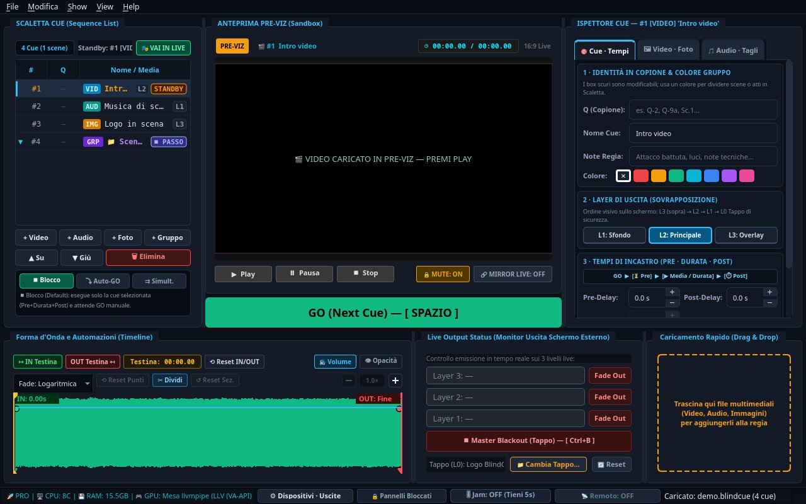

<p align="center">
  
</p>

<h1 align="center">BlindCUE — Open-Source Audio/Video Cue Player for Live Shows</h1>

<p align="center">
  <b>An open-source QLab alternative for Linux, Windows and macOS.</b><br>
  Cue-based playback for theatre, dance, concerts and live events: a separate director console and a clean stage output,<br>
  three projection layers, LAN remote control (web + OSC). No cloud, no proprietary dependencies.
</p>

<p align="center">
  <a href="https://www.python.org/"></a>
  <a href="https://wiki.qt.io/Qt_for_Python"></a>
  
  
  
  <a href="LICENSE"></a>
</p>

---

## What is BlindCUE

**BlindCUE** is a free, open-source **cue player** for live shows — theatre,
dance, concerts, contests and performances. You build a cue list of **audio,
video and image** cues, then fire them on stage with fail-safe, panic-ready
controls.

The core idea: **the audience must never see a desktop, a system window or a
technical manoeuvre.** BlindCUE keeps two worlds physically separate:

| Environment | Where | What it shows |
|---|---|---|
| **Director** | Operator's primary monitor | Cue list, inspector, preview, waveform |
| **Stage output** | Projector / stage display (a second screen; a third for dual output) | Only the live video layers, full screen |

## Why BlindCUE — a QLab alternative for Linux and Windows

The reference tool for live cueing, [QLab](https://qlab.app), is macOS-only and
commercial. BlindCUE is the open-source alternative for the machines QLab does
not cover:

- **Linux first**: native Wayland only (X11 is not supported), PipeWire/PulseAudio, VA-API hardware video decoding.
- **Also Windows and macOS**: the same codebase runs on Windows 10/11 and on macOS (Apple Silicon and Intel).
- **Lightweight**: no embedded web runtime, no database, no external service. Python + Qt + FFmpeg.
- **Open source only**: no proprietary dependency, no paid API, no account, no cloud.

> **Trademark notice.** QLab is a trademark of Figure 53, LLC. BlindCUE is an
> independent open-source project and is **not affiliated with, endorsed by or
> sponsored by** Figure 53, LLC. The name is used only to describe compatibility
> and as an alternative; BlindCUE does not use the QLab logo or code.

## Project status

**Ready to use, still evolving.** The current version is `0.1.x`: the features
below are implemented and tested, but the project is young.

**How it is built.** BlindCUE is developed by Diego Costanzo with AI pair
programming and verified on real hardware. It is not a commercial product with
guaranteed support: it is an open-source project born from a real show.

**How tested.** Every release passes about 230 automated checks on Linux:
150 `pytest` tests plus five harnesses (functional, sections, live groups,
integration, mixin fuzz) that drive the real application with real media. See
[docs/TEST_FINDINGS.md](docs/TEST_FINDINGS.md) and
[docs/AUDIT_LOGBOOK.md](docs/AUDIT_LOGBOOK.md).

**Not verified yet.** Deep testing has been on Linux (Wayland). Not yet
covered: codecs beyond H.264 (HEVC, VP9, ProRes), 4K/10-bit files, 5.1/7.1 audio
on an external system, projector edge blending, continuous sessions over
10 minutes. Before a real show, run a full dress rehearsal with your own
computer, projector and files — that applies to any live software.

## Highlights

- Separate **director console** and **stage output**; three projection layers, six with two independent projectors.
- **Cue list** for video, audio, images and groups (scenes) with pre/post-delay, fades and auto-follow.
- Groups in five modes: **simultaneous, sequential, step, random, loop**.
- **Sections** (A/B/C…) with N-time loops or infinite vamp, jump and skip.
- **Envelopes** for volume and opacity with keyframes and log/S-curve fades.
- Separate **room master** and **headphone PFL** audio routing, EBU R128 loudness, non-destructive normalisation.
- **Projection mapping**: automatic projector detection, span, dual independent outputs, surfaces, masks, keystone.
- **LAN remote**: mobile-first web remote (QR + PIN), director monitor, native OSC server.
- **Failsafes**: atomic saves, autosave + crash recovery (including surfaces), OS sleep/screensaver inhibition, global pause, panic, 40-step undo/redo, dedicated CPU budget.

## Install

One command on all three systems:

```bash
git clone https://github.com/diego-costanzo/BlindCUE.git
cd BlindCUE
python3 setup.py            # opens the installer window
```

Installs per-user, no `sudo`, no UAC. On Linux the application is
**Wayland-native only** (X11 is not supported). The installed copy is
self-contained: after setup you can delete the cloned folder; a standalone
uninstaller is left next to the application.

See the Italian guide below for details (requirements, per-system commands,
uninstall).

## Quick start

1. Connect the projector and set the OS to **"Extend display"** (never "Duplicate").
2. Launch BlindCUE: the director window goes on the primary monitor, the output on the second screen.
3. Drop audio/video/image files into the **Drop Zone**, or build cues from the cue list.
4. Tune **pre-delay, fade, volume, layer and surface** in the inspector.
5. Press **`F5`** to enter **LIVE mode**.
6. **`SPACE`** for GO. **`Ctrl+B`** for blackout. **`ESC ×2`** (double tap within 0.6s) for Panic (or instant click on the PANIC button).

---

## Italiano

La guida completa (installazione, scorciatoie, struttura, test, licenza) è in
italiano qui sotto.

---

## Indice

- [Cos'è BlindCue](#cosè-blindcue)
- [Perché esiste](#perché-esiste)
- [Stato del progetto](#stato-del-progetto)
- [Caratteristiche](#caratteristiche)
- [Screenshot](#screenshot)
- [Requisiti](#requisiti)
- [Installazione](#installazione)
- [Avvio rapido](#avvio-rapido)
- [Scorciatoie essenziali](#scorciatoie-essenziali)
- [Struttura del progetto](#struttura-del-progetto)
- [Test](#test)
- [Documentazione](#documentazione)
- [Contribuire](#contribuire)
- [Licenza](#licenza)

---

## Cos'è BlindCue

BlindCue è un **cue player** per teatro, danza, concerti, contest e performance dal vivo. Permette di costruire una scaletta di cue audio, video e immagini, e di eseguirla in scena con comandi a prova di errore.

Il principio è semplice: **il pubblico non deve mai vedere il desktop, una finestra di sistema o una manovra tecnica**. Per questo BlindCue separa fisicamente due ambienti:

| Ambiente | Dove | Cosa mostra |
|---|---|---|
| **Regia** | Monitor primario dell'operatore | Scaletta, ispettore, anteprima, forma d'onda |
| **Uscita** | Proiettore / display di scena (secondo monitor; un terzo monitor per la doppia uscita) | Solo i layer video in onda, a tutto schermo |

---

## Perché esiste

**BlindCue nasce nativo per Linux.** Su Linux mancano strumenti live show validi, leggeri e davvero pensati per il palco: le alternative sono o pesanti, o pensate per altri sistemi operativi, o legate a servizi cloud e licenze.

BlindCue vuole essere l'alternativa che mancava:

- **Linux prima di tutto**: Wayland nativo, PipeWire/PulseAudio, VA-API per la decodifica video hardware. X11 non è supportato.
- **Leggero**: nessun runtime web dentro l'app, nessun database, nessun servizio esterno. Python + Qt + FFmpeg.
- **Solo open source**: nessuna dipendenza proprietaria, nessuna API a pagamento, nessun account.
- **Usabile anche altrove**: la stessa base gira su **macOS** (Apple Silicon e Intel) e **Windows 10/11**, perché lo spettacolo non sempre si fa sul computer giusto.

---

## Stato del progetto

**Pronto per l'uso, in evoluzione.** La versione attuale è la `0.1.x`: le funzioni
descritte qui sotto sono implementate e collaudate, ma il progetto è giovane e
continua a cambiare.

**Come è fatto.** BlindCue è sviluppato da Diego Costanzo con l'assistenza di
strumenti di intelligenza artificiale (pair programming), poi verificato a mano
su hardware reale. Non è un prodotto commerciale con supporto garantito: è un
progetto open source che nasce dal bisogno concreto di uno spettacolo dal vivo.

**Quanto è testato.** Ogni rilascio passa circa 230 verifiche automatiche su
Linux:

| Verifica | Casi | Copre |
|---|---|---|
| `pytest tests/` | 150 | Macchina a stati, sezioni, envelope, persistenza, robustezza, integrazione, regressioni audit |
| suite funzionale | 49 | Rendering pixel-level, media reali, logica, gruppi, persistenza, doppia uscita |
| sezioni live | 11 | Sezioni, skip, vamp, salti su playback audio e video reale |
| gruppi live | 6 | STEP, SEQUENCE, SIMULTANEOUS, LOOP, RANDOM su media veri |
| integrazione | 12 | Gruppi annidati/vuoti, PANIC/BLACKOUT in scena, 300 GO, 100 salti |
| fuzz dei mixin | 5 | 400-600 operazioni UI casuali con invarianti e controllo risorse |

Dettaglio dei bug trovati e corretti, con il metodo usato per trovarli:
[docs/TEST_FINDINGS.md](docs/TEST_FINDINGS.md) e [docs/AUDIT_LOGBOOK.md](docs/AUDIT_LOGBOOK.md).

**Cosa non è stato ancora verificato.** Windows e macOS sono supportati
dall'installer ma il collaudo approfondito è stato fatto su Linux (Wayland).
X11 non è supportato. Non sono stati provati: codec oltre H.264 (HEVC, VP9, ProRes), file 4K o
10 bit, audio multicanale 5.1/7.1 su impianto esterno, edge blending tra due
proiettori sovrapposti, sessioni continue oltre i 10 minuti.

**Consiglio pratico.** Prima di uno spettacolo vero, fai una prova generale con
il tuo computer, il tuo proiettore e i tuoi file. Vale per qualunque software
live, non solo per questo: è l'unico test che nessuna suite automatica può
sostituire.

---

## Caratteristiche

### Tre layer di proiezione + layer di sicurezza

- **Layer 1** sfondo, **Layer 2** principale, **Layer 3** overlay: indipendenti e sovrapponibili in tempo reale.
- Ogni layer gestisce **video e immagine in modo indipendente**, con **deck A/B** per il cambio di media senza buco nero.
- **Layer 0 (Tappo)**: quando non c'è nulla in onda, il proiettore mostra un reticolo di calibrazione ottica oppure un'immagine di blackout personalizzata.

### Cue e scaletta

- Media **video**, **audio**, **immagini** e **gruppi** (scene).
- Tempi separati: **Pre-Delay**, durata media, **Post-Delay**, hold per le immagini.
- Modalità di avanzamento: **manuale**, **auto-follow**, **simultanea**.
- Gruppi con cinque modalità: **simultaneo**, **sequenziale**, **passo-passo**, **random**, **loop**.
- **Studio Timeline** multi-traccia per comporre visivamente le scene su 3 layer.
- **Sezioni virtuali** (A/B/C…) con loop N volte o vamp infinito, salto e skip.
- **Envelope** di volume e opacità a keyframe, con curve di fade logaritmiche, S-curve o lineari.

### Audio

- Routing separato **Master Sala** e **monitor PFL** in cuffia su dispositivi distinti.
- Analisi **EBU R128** (LUFS integrato e True Peak) per pareggiare il volume tra le tracce.
- Normalizzazione **non distruttiva** e ottimizzazione dinamica con limitazione di picco.
- **Modalità Jam / Contest**: auto-gain su tutte le cue per file non calibrati.

### Video mapping

- **Rilevamento automatico dei proiettori**: BlindCue usa solo gli schermi esterni al monitor di regia. Un proiettore → uscita A; due proiettori → uscita A e B, con scelta esplicita di quale proiettore alimenta ciascuna uscita nel pannello dei layer. Nessun proiettore → uscita in finestra sul monitor di regia, per le prove.
- **Audio multi-scheda**: BlindCue elenca le uscite audio del sistema operativo. Con una sola uscita stereo il monitor cuffia (PFL) viene disattivato; collegando una seconda scheda audio il routing di regia si riattiva.
- **Tre modalità di uscita esplicite**: singolo proiettore, **superficie unica (span)** con due proiettori uniti in un'unica tela continua, oppure **due uscite indipendenti** con tre layer per ciascun proiettore. La modalità è salvata nel progetto e ricordata al riavvio.
- **Assegnazione per uscita**: ogni cue sceglie il proiettore (A o B) e il proprio layer; i conflitti sono calcolati separatamente per le due uscite.
- **Superfici virtuali multiple** con due modalità: rettangolo (split screen, PiP, multi-proiettore) e **quad keystone a 4 punti**.
- **Maschere** rettangolari, ellittiche, forate o da PNG, con feather dei bordi.
- **Soft edge blend** per la sovrapposizione tra proiettori adiacenti.
- **Guide di calibrazione** proiettabili sul palco (reticolo + contorni superfici).

### Controllo remoto

- **Web Remote** mobile-first su LAN: pulsante GO grande, accesso via **QR code**, protezione **PIN** a 6 cifre.
- **Monitor Regista** in sola lettura, per direzione artistica e scena.
- **Server OSC** UDP nativo con comandi `/go`, `/panic`, `/blackout`, `/pause`, `/cue/<id>/go`, `/volume`.
- Tutto **opt-in**: i servizi di rete sono spenti finché non li attivi.

### Resilienza

- Salvataggio **atomico** su file JSON aperto (`.blindcue`).
- **Archivio portatile** opzionale: al salvataggio puoi copiare i media dentro la cartella dello show e lo spettacolo si apre su qualunque computer. I file originali non vengono mai spostati né modificati.
- **Autosave** ogni 30 secondi e **Crash Recovery** al riavvio (incluse le superfici di proiezione).
- **Inibizione sospensione/screensaver** integrata a livello di sistema operativo (`systemd-inhibit` su Linux) finché BlindCue è aperto.
- **Pausa globale** senza drift e **Panic** a 0 ms (doppia pressione `ESC ×2` anti-errore da tastiera, click istantaneo sul pulsante).
- **Undo/Redo** fino a 40 passaggi.
- **Budget CPU** dedicato: il lavoro in background non satura mai tutti i core.

---

## Screenshot

<p align="center">
  
</p>

---

## Requisiti

| Componente | Minimo | Note |
|---|---|---|
| **Python** | 3.10 | 3.12+ consigliato |
| **FFmpeg** | qualsiasi build recente | Necessario per waveform, loudness e normalizzazione |
| **RAM** | 4 GB (profilo Eco) | 8 GB+ consigliati per video multipli |
| **GPU** | Qualsiasi con driver aggiornati | VA-API su Linux, VideoToolbox su macOS, D3D11VA su Windows |
| **Display** | 2 schermi consigliati | Il secondo schermo è l'uscita di scena; la doppia uscita indipendente ne richiede un terzo |

L'installer verifica automaticamente Python, RAM, spazio disco, rete, server audio (PipeWire/PulseAudio/ALSA), display (Wayland obbligatorio) e accelerazione GPU.

---

## Installazione

Un solo comando, uguale su tutti e tre i sistemi: `setup.py` riconosce il sistema operativo e delega l'installazione alla cartella giusta (`setup/linux`, `setup/macos`, `setup/windows`).

```bash
git clone https://github.com/diego-costanzo/BlindCUE.git
cd BlindCUE
python3 setup.py            # apre la finestra di installazione
```

La finestra (tema scuro BlindCUE, senza terminale) spiega cosa verrà fatto, mostra l'avanzamento e i controlli in tempo reale, e alla fine offre **Avvia BlindCue**. L'installazione è **per il solo utente e senza password**: nessun `sudo`, nessun UAC.

| Sistema | Dove viene installato | Come si avvia |
|---|---|---|
| **Linux** | `~/.local/share/blindcue` | comando `blindcue`, icona nel menu applicazioni e sul Desktop |
| **macOS** | `~/Applications/BlindCue.app` | icona nel Launchpad / Finder |
| **Windows** | `%LOCALAPPDATA%\Programs\BlindCue` | icona sul Desktop e nel menu Start |

Il programma viene **copiato** nella sua cartella definitiva: la cartella del repository scaricato può anche essere cancellata. I tuoi progetti restano dove li hai salvati e l'autosave vive in `~/.config/blindcue`, quindi un aggiornamento non li tocca.

L'installazione lascia accanto al programma un **disinstallatore autonomo**, che non dipende più dal repository: `blindcue-uninstall` e la voce **Rimuovi BlindCue** su Linux, `BlindCue Uninstall.command` su macOS, `BlindCue-uninstall.bat` e **Uninstall BlindCue** nel menu Start su Windows.

### Opzioni da terminale

```bash
python3 setup.py --terminal    # installazione testuale, senza finestra
python3 setup.py --check       # solo diagnostica, non installa nulla
python3 setup.py --yes         # installazione non interattiva
python3 setup.py --run         # avvia BlindCue se già installato
python3 setup.py --uninstall   # rimuove l'installazione dell'utente
```

### Disinstallazione

```bash
python3 uninstall.py           # finestra di conferma, rimuove programma e collegamenti
python3 uninstall.py --purge   # rimuove anche impostazioni e autosave
```

Puoi anche usare il disinstallatore creato dall'installer, senza il repository:
`blindcue-uninstall` o **Rimuovi BlindCue** nel menu applicazioni (Linux),
`BlindCue Uninstall.command` (macOS), **Uninstall BlindCue** nel menu Start (Windows).

La disinstallazione elimina programma, collegamenti di avvio e icona nel menu di sistema, senza lasciare tracce. **I tuoi progetti `.blindcue` non vengono mai toccati**; l'autosave resta disponibile a meno che tu non scelga `--purge`.

### Linux (piattaforma principale)

```bash
./setup/linux/install.sh       # installazione diretta, senza GUI
./setup/linux/run.sh           # avvio
```

Opzioni di `install.sh`: `--check`, `--yes`, `--no-sudo`, `--no-gpu`, `--prefix DIR` (installa in una cartella alternativa, utile per prove).
Supporto testato per **Debian/Ubuntu**, **Arch/EndeavourOS**, **Fedora**.

BlindCue gira **solo su Wayland**: X11 non è supportato e le librerie `xcb` non vengono installate. L'installer verifica la sessione Wayland e si ferma con un messaggio chiaro se non la trova. L'unica eccezione è la finestra di setup, che usa Tkinter e quindi passa da XWayland: l'applicazione vera e propria è Wayland nativa. L'installer installa anche `python3-tk` per quella finestra.

### macOS

```bash
./setup/macos/install.command
./setup/macos/run.command
```

Crea un bundle vero in `~/Applications`: icona, Launchpad e Finder. Se `tkinter` non è disponibile (Python di Homebrew), l'installer grafico propone `brew install python-tk`. Poiché il bundle non è firmato, al primo avvio può comparire l'avviso di Gatekeeper: tasto destro → **Apri**.

### Windows

```bat
setup\windows\install.bat
setup\windows\run.bat
```

L'installer verifica Python ≥ 3.10, RAM, disco e rete, installa FFmpeg via `winget` se assente e crea i collegamenti con l'icona di BlindCue. I collegamenti puntano a `pythonw.exe`, quindi **non si apre nessuna finestra di terminale**.

### Installazione manuale (sviluppo)

```bash
python3 -m venv .venv
source .venv/bin/activate        # Windows: .venv\Scripts\activate
pip install -r requirements.txt
python blindcue/main.py
```

---

## Avvio rapido

1. Collega il proiettore e imposta il sistema in **"Estendi schermo"** (mai "Duplica").
2. Avvia BlindCue: la finestra di regia va sul monitor primario, l'uscita sul secondo schermo.
3. Trascina file audio/video/immagini nella **Drop Zone**, oppure crea cue dalla scaletta.
4. Regola **Pre-Delay**, **fade**, **volume**, layer e superficie nell'ispettore.
5. Premi **`F5`** per entrare in **Modalità LIVE**.
6. **`SPAZIO`** per il GO. **`Ctrl+B`** per il blackout. **`ESC ×2`** (entro 0,6 s) per il Panic da tastiera.

### Salvare uno show: collegamenti o archivio portatile

Con **Salva con nome** (`Ctrl+Shift+S`) BlindCue chiede come vuoi salvare:

| Scelta | Cosa succede | Quando usarla |
|---|---|---|
| **No** (predefinito) | Salva solo i collegamenti ai file originali | I media restano dove sono e li gestisci tu |
| **Sì** | Copia i media in `<nome>_media/` accanto al file `.blindcue` | Vuoi portare lo show su un altro computer con una chiavetta |

L'archivio portatile usa percorsi relativi (inclusi Layer 0 personalizzato e maschere PNG delle superfici), quindi la cartella dello show si può
spostare o copiare integralmente. I file originali **non vengono mai modificati
né spostati**, i nomi uguali con contenuto diverso vengono disambiguati tramite verifica SHA-256 (`clip.mp4` → `clip_2.mp4`) e,
se un file non è copiabile, lo show viene salvato comunque con un avviso che
elenca i media rimasti collegati. All'apertura BlindCue segnala subito gli
eventuali media mancanti.

---

## Scorciatoie essenziali

| Tasto | Azione |
|---|---|
| `SPAZIO` | GO — esegue la cue in standby |
| `ESC ×2` / `ESC` | PANIC in LIVE (doppia pressione entro 0,6 s) / stop anteprima in Progetto |
| `Ctrl+B` | Blackout verso il tappo di sicurezza |
| `F5` / `Ctrl+L` | Entra/esci dalla Modalità LIVE |
| `F7` | Studio superfici di proiezione e video mapping |
| `Shift+F7` | Mostra/nascondi guide di calibrazione sul proiettore |
| `F8` | Controllo remoto LAN (Web e OSC) |
| `Ctrl+G` | Raggruppa le cue selezionate in una scena |
| `Ctrl+Shift+G` | Estrai la cue selezionata dal gruppo |
| `Del` / `Backspace` | Elimina cue selezionate |
| `Alt+↑` / `Alt+↓` | Sposta la cue su o giù |
| `I` / `O` | Aggancia IN / OUT al playhead |
| `Ctrl+Z` / `Ctrl+Shift+Z` / `Ctrl+Y` | Undo / Redo |
| `Ctrl+N` `Ctrl+O` `Ctrl+S` `Ctrl+Shift+S` | Nuovo, Apri, Salva, Salva con nome |

Il riferimento completo è nel [Manuale Utente](docs/MANUAL.md#scorciatoie).

---

## Struttura del progetto

```text
BlindCUE/
├── blindcue/
│   ├── main.py              # Entry point, bootstrap, wiring dei player
│   ├── assets/              # Logo usato dal programma (Layer 0 e icona finestra)
│   ├── models/              # Cue, superfici di proiezione, persistenza
│   ├── engine/              # Player live, scheduler, envelope, loudness, show engine
│   ├── services/            # Web Remote (HTTP+SSE), OSC, QR, coordinamento remoto
│   └── ui/                  # Widget Qt; il pacchetto main_window/ è suddiviso in mixin
├── tests/                   # Suite headless: robustezza, integrazione, show engine
├── docs/                    # ARCHITECTURE.md, MANUAL.md, TEST_FINDINGS.md, AUDIT_LOGBOOK.md
├── immagini di progetto/    # Screenshot per questo README
├── setup.py                 # installer universale: rileva l'OS e apre la GUI
├── uninstall.py             # disinstallazione guidata: rimuove tutto, senza tracce
├── setup/
│   ├── common/              # finestra di installazione (tkinter) e logica condivisa
│   ├── linux/               # install.sh + run.sh
│   ├── macos/               # install.command + run.command (bundle .app)
│   ├── windows/             # install.bat + run.bat
│   └── assets/              # icone png/ico/icns del programma
└── run.sh / run.bat         # avvio dal codice sorgente (per lo sviluppo)
```

Dettaglio dei moduli, flusso dati e guida all'estensione: **[docs/ARCHITECTURE.md](docs/ARCHITECTURE.md)**.

---

## Test

La suite gira **headless** (backend Qt `offscreen`) e non richiede un display:

```bash
# Tutta la suite (150 test)
QT_QPA_PLATFORM=offscreen pytest -q tests/

# Solo la macchina a stati dello show (nessuna dipendenza Qt, millisecondi)
pytest -q tests/test_show_engine_pure.py
```

| File | Copre |
|---|---|
| `test_show_engine_pure.py` | Transizioni LIVE/LOADED, catene, gruppi, auto-follow (puro Python) |
| `test_show_engine.py` | GO, pre-delay, gruppi, sezioni, envelope con finestre reali |
| `test_sections_playback.py` | Sezioni su playback reale: loop, skip, vamp, salti, break |
| `test_media_transforms.py` | Crop, scala, posizione, rotazione, aspect ratio, colore |
| `test_output_modes.py` | Uscita singola, span, doppia uscita indipendente |
| `test_dual_output.py` | Deck A/B, handoff senza stutter, layer per uscita |
| `test_live_robustness.py` | Stress OSC, fuzz, file corrotti, zombie FFmpeg, archivio portatile |
| `test_live_integration.py` | Remote manager, segnali, cache stato, autosave, boot headless |
| `test_audit_regressions.py` | Regressioni audit live: shortcut, fallback race, lock layer, deck swap, SSE/OSC, sleep inhibitor |

Oltre a pytest, il collaudo include harness che guidano la vera applicazione con
media reali e controllano il comportamento osservabile (posizione del playhead,
stato dei player, pixel renderizzati, file JSON prodotto). Non fanno parte del
repository perché richiedono file multimediali campione e sono stati pensati per
girare su una macchina dedicata:

| Harness | Casi | Cosa verifica |
|---|---|---|
| funzionale | 49 | Rendering, media reali, logica, gruppi, persistenza, doppia uscita |
| sezioni | 11 | Sezioni su playback audio e video reale |
| gruppi live | 6 | Le cinque modalità di gruppo su media veri |
| integrazione | 12 | Casi limite: gruppi annidati/vuoti, PANIC/BLACKOUT, 300 GO, 100 salti |
| fuzz mixin | 5 | 400-600 operazioni UI casuali, invarianti dopo ogni passo, fd/thread |

Il resoconto completo dei bug trovati e del metodo usato è in
[docs/TEST_FINDINGS.md](docs/TEST_FINDINGS.md).

---

## Documentazione

- **[Manuale Utente](docs/MANUAL.md)** — uso quotidiano, tutte le funzioni, scorciatoie, emergenze, troubleshooting.
- **[Architettura](docs/ARCHITECTURE.md)** — struttura interna, flusso dati, concorrenza, come estendere o fare fork.
- **[Collaudo](docs/TEST_FINDINGS.md)** — collaudo su hardware reale, prestazioni misurate e bug risolti.
- **[Diario di Bordo Audit](docs/AUDIT_LOGBOOK.md)** — audit di affidabilità live, correzioni applicate e checklist per le iterazioni future.

---

## Contribuire

Il progetto è aperto a contributi, segnalazioni e fork.

- **Bug**: apri una issue con sistema operativo, versione Python, cosa hai fatto e cosa ti aspettavi.
- **Modifiche**: mantieni verde la suite (`pytest -q tests/`). I test sono la rete di sicurezza dello show: una modifica senza test verdi non entra.
- **Stile**: Python 3.10+, type hints moderni, nessuna dipendenza proprietaria, nessun servizio cloud obbligatorio.
- **Nuove funzioni**: se toccano la logica di scena, aggiungi prima il test in `tests/test_show_engine_pure.py`.

Prima di mettere mano al codice, leggi [docs/ARCHITECTURE.md](docs/ARCHITECTURE.md): spiega dove vive ogni responsabilità e perché il confine tra UI e motore è dove è.

---

## Licenza

Rilasciato sotto licenza **MIT** — Copyright (c) 2026 **Diego Costanzo**.

Puoi usare, modificare, distribuire e vendere il software, anche in progetti chiusi, senza obblighi oltre a mantenere l'avviso di copyright. Vedi [LICENSE](LICENSE).
