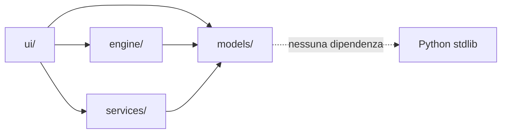
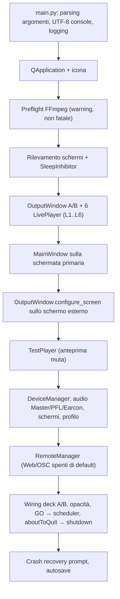
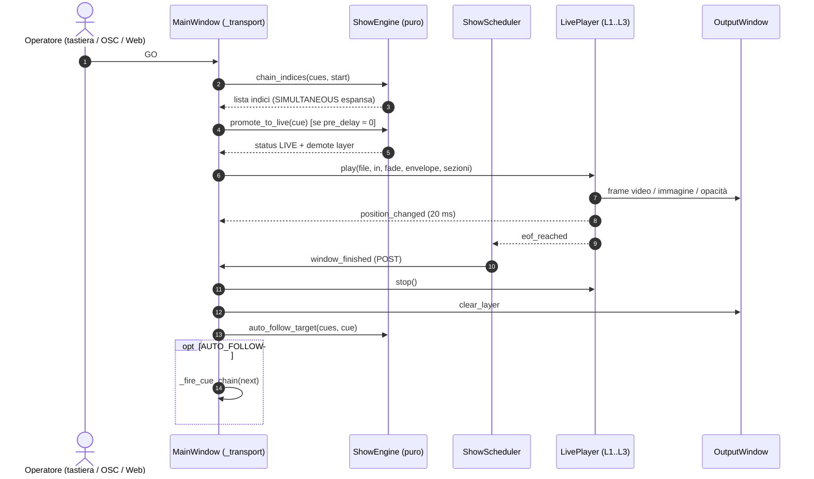

# Architettura e guida per sviluppatori — BlindCue

Documento tecnico per chi vuole **manutenere, estendere, correggere o fare un fork** di BlindCue.
Descrive come è organizzato il codice, dove vive ogni responsabilità, quali sono i confini da non violare e come verificare le modifiche.

Per l'uso del software vedi il **[Manuale Utente](MANUAL.md)**; per la cronologia di collaudo e audit vedi **[TEST_FINDINGS.md](TEST_FINDINGS.md)** e **[AUDIT_LOGBOOK.md](AUDIT_LOGBOOK.md)**.

---

## Indice

1. [Filosofia di progetto](#1-filosofia-di-progetto)
2. [Requisiti di sviluppo](#2-requisiti-di-sviluppo)
3. [Mappa dei pacchetti](#3-mappa-dei-pacchetti)
4. [Flusso di esecuzione](#4-flusso-di-esecuzione)
5. [Ciclo di vita di una cue](#5-ciclo-di-vita-di-una-cue)
6. [Il pacchetto `ui/main_window/`](#6-il-pacchetto-uimain_window)
7. [Il motore di scena puro](#7-il-motore-di-scena-puro)
8. [Concorrenza e thread-safety](#8-concorrenza-e-thread-safety)
9. [Budget CPU e priorità](#9-budget-cpu-e-priorità)
10. [Persistenza e crash recovery](#10-persistenza-e-crash-recovery)
11. [Servizi di rete](#11-servizi-di-rete)
12. [Testing](#12-testing)
13. [Come estendere BlindCue](#13-come-estendere-blindcue)
14. [Guardrail e anti-pattern](#14-guardrail-e-anti-pattern)
15. [Checklist per una pull request](#15-checklist-per-una-pull-request)

---

## 1. Filosofia di progetto

BlindCue è un software **real-time per il palco**. Ogni scelta architetturale risponde a tre domande, in quest'ordine:

1. **Può causare un glitch durante lo show?** Se sì, va evitato o isolato.
2. **Resta leggero?** Nessun servizio cloud obbligatorio, nessun database, nessuna dipendenza proprietaria.
3. **È riparabile da un non-programmatore?** Log chiari, errori espliciti, recupero automatico.

Il progetto è **Linux-first**: Wayland nativo (X11 non è supportato), PipeWire/PulseAudio, VA-API. macOS e Windows sono supportati dalla stessa base grazie a Qt6 e ai fallback in `runtime_limits.py`, ma le ottimizzazioni e i test manuali hanno priorità Linux.

**Vincolo di licenza**: solo software open source. Nessun richiamo a SDK o codec proprietari.

---

## 2. Requisiti di sviluppo

```bash
python3 -m venv .venv
source .venv/bin/activate
pip install -r requirements.txt
QT_QPA_PLATFORM=offscreen pytest -q tests/
```

| Strumento | Versione | Uso |
|---|---|---|
| Python | ≥ 3.10 | `from __future__ import annotations`, PEP 585/604 |
| PySide6 | ≥ 6.6, < 7 | GUI, multimedia (backend FFmpeg), rete |
| NumPy | ≥ 1.24, < 3 | Picchi waveform |
| qrcode | ≥ 7.4.2, < 9 | QR nel Web Remote |
| FFmpeg / FFprobe | qualsiasi build recente | Waveform, EBU R128, normalizzazione |

Gli upper bound delle dipendenze sono intenzionali: un major release inatteso non deve rompere uno spettacolo.

---

## 3. Mappa dei pacchetti

```text
blindcue/
├── main.py                     # Bootstrap: QApplication, schermi, player, wiring, shutdown
├── models/                     # Dati puri, serializzabili, senza rendering
│   ├── cue.py                  # Cue, CueSection, enum (MediaType, CueStatus, FollowMode, GroupMode)
│   ├── surface.py              # SurfaceDefinition: rettangolo e quad keystone, maschere, blend
│   ├── output_config.py        # OutputMode single/span/dual: come la/e finestra/e si mappano sui display
│   └── project_manager.py      # .blindcue JSON, scrittura atomica, autosave, crash recovery
├── engine/                     # Tutto ciò che produce audio/video o calcola tempo
│   ├── show_engine.py          # ★ Macchina a stati pura (zero Qt)
│   ├── show_scheduler.py       # Pre/Post-Delay, pausa globale, tick monotonic 33 ms
│   ├── envelope.py             # Curve di fade, keyframe, SectionSequencer
│   ├── player_live.py          # LivePlayer: deck A/B, envelope a 50 Hz, sezioni
│   ├── player_test.py          # TestPlayer: pre-ascolto PFL isolato
│   ├── audio_analyzer.py       # Waveform streaming O(width), EBU R128, loudnorm atomico via FFmpeg
│   ├── device_manager.py       # Routing audio (Master/PFL/Earcon), schermi A/B, profili hardware
│   ├── hardware_profile.py     # Profiler hardware (cache statica), probe VA-API reale, ShowRuntimeGuard
│   ├── sleep_inhibitor.py      # Anti-sospensione/screensaver cross-platform 100% stdlib
│   ├── runtime_limits.py       # ★ Budget CPU/thread condiviso
│   └── earcon.py               # Segnali acustici di conferma (instradati su cuffia PFL)
├── services/                   # Rete, sempre disaccoppiata dalla GUI
│   ├── osc_protocol.py         # OSC 1.0 binario puro Python
│   ├── osc_server.py           # QUdpSocket → RemoteManager
│   ├── web_server.py           # HTTP + SSE, PIN, rate limiting
│   ├── qr_generator.py         # QR in puro Python (GF(256), Reed-Solomon)
│   └── remote_manager.py       # Coordinator: bridge segnali Qt, stato live, PIN
└── ui/                         # Solo presentazione e input
    ├── main_window/            # ★ Pacchetto di mixin (vedi §6)
    ├── output_window.py        # Finestra di scena borderless, compositing 3 layer + Layer 0
    ├── live_show_view.py       # Modalità LIVE: scaletta estesa, GO, PAUSA, PANIC, orologio
    ├── inspector_panel.py      # Ispettore: tempi, geometria, audio, gruppi
    ├── waveform_widget.py      # Forma d'onda: IN/OUT, zoom 32x, envelope, sezioni
    ├── group_timeline_editor.py# Studio Timeline multi-traccia per i gruppi
    ├── surface_mapping_dialog.py# Studio superfici e video mapping
    ├── device_settings_dialog.py# Dispositivi, routing, profilo hardware
    ├── remote_control_dialog.py# QR, PIN, porte, monitor regista
    └── ...                     # Pannelli, spinbox, tema, layout
```

### La regola delle dipendenze



- `models/` **non importa** nulla da `engine/`, `ui/`, `services/`.
- `engine/show_engine.py` e `engine/envelope.py` **non importano Qt**: sono testabili senza display.
- `ui/` può importare tutto; nessun altro pacchetto importa da `ui/`.
- `services/` non tocca i widget: emette segnali, il `RemoteManager` li inoltra.

> Se ti trovi a importare `ui` dentro `engine`, la logica sta nel posto sbagliato: spostala nel motore e fai emettere un segnale alla UI.

### Routing delle uscite video

La mappatura della finestra di uscita sui display è esplicita e vive in un unico posto:

| Pezzo | Ruolo |
|---|---|
| `models/output_config.py` | `OutputMode.SINGLE` / `SPAN` / `DUAL` + normalizzazione |
| `models/cue.py` | `Cue.output_target` (`"A"`/`"B"`), `runtime_layer()`, `layer_label()`, `resolve_output_target()` |
| `DeviceManager` | stato, `set_output_mode()`, fallback sicuro, persistenza `QSettings("output/mode")`, `register_secondary_output_window()` |
| `OutputWindow` | `enter_span_mode(screens)`, `is_spanning()`, `configure_screen()`; in DUAL ne esistono due istanze |
| `main.py` | due `OutputWindow` e sei `LivePlayer` (runtime layer 1-6) |

**Mappa dei runtime layer.** Le cue dichiarano un layer logico 1-3 e un `output_target` A/B. Il runtime slot è la coppia `(uscita, layer)` codificata in un intero:

```python
def runtime_layer(layer: int, output_target: str = "A") -> int:
    if normalize_output_target(output_target) == "B":
        return int(layer) + 3   # B: 4-6
    return int(layer)           # A: 1-3
```

Le strutture runtime (`active_live_cues`, `layer_fire_gen`, `live_positions`, `live_durations`, `ShowScheduler.pending_for_layer`) restano liste/dizionari indicizzati 1-6: nessuna struttura a coppie. Gli helper `_out_window(layer)` e `_local_layer(layer)` in `main.py` traducono il runtime layer nella finestra corretta e nell'indice 1-3 al suo interno.

Regole da rispettare:

1. **Mai indovinare la modalità.** O è `single`, o è `span`, o è `dual`, ed è salvata nel progetto (blocco `settings["output"]`) e in `QSettings`.
2. **Il fallback non deve mai lasciare il proiettore nero.** Se span/dual non sono applicabili, `DeviceManager` torna a `single` ed emette `output_mode_changed`.
3. **Il primario è sempre la regia.** Lo span e il dual usano solo gli schermi non primari.
4. **Wayland non garantisce lo spanning.** `span_warning()` espone il limite alla UI; il codice non lo nasconde con un `try/except` silenzioso.
5. **Lo span condivide i layer, il dual li moltiplica.** Lo span unisce la tela: tre layer in totale. Il dual apre due finestre: tre layer per uscita, sei runtime slot.
6. **Il target viaggia con la cue.** Ogni transizione di stato (`promote_to_live`, `demote_live_on_layer`, `clear_layer`) e il calcolo dei conflitti usano la chiave `(output_target, layer)`: un GO su B non deve mai declassare una cue live sullo stesso layer di A.
7. **Il ripristino DUAL attende entrambe le finestre.** `register_output_window()` non applica il dual finché `register_secondary_output_window()` non è stato chiamato, altrimenti registrerebbe un fallback prematuro a `single`.
8. **Una cue su B non sparisce mai.** `resolve_output_target(output_target, dual_active)` è la fonte di verità: con il dual spento restituisce `"A"`, così una cue assegnata a B viene proiettata sul proiettore unico invece di finire in una finestra nascosta. Ogni chiamata a `runtime_layer`, `_effective_layer`, `_runtime_slot`, `promote_to_live`, `demote_live_on_layer`, `clear_layer` e `detect_layer_conflicts` deve passare `dual_active` coerente con la modalità corrente (`MainWindow._dual_output_active` / `DeviceManager.get_output_mode()`). Quando il dual viene disattivato, gli eventuali layer 4-6 ancora live vengono fermati e segnalati in barra di stato.
9. **I proiettori sono scelti esplicitamente, mai indovinati.** `DeviceManager._resolve_output_screens()` assegna gli schermi esterni alle uscite: nessun proiettore esterno → tutto sul monitor di regia; un proiettore → solo uscita A; due o più → A e B, con l'assegnazione salvata in `QSettings("output/screen_a"/"output/screen_b")`. L'operatore può scambiare A e B dal pannello dei layer (`LiveStatusPanel.set_output_monitors` → `output_screen_changed` → `MainWindow._on_output_screen_selected` → `DeviceManager.set_output_screen`). `get_dual_screens()` usa sempre l'assegnazione manuale finché entrambi gli schermi restano collegati.
10. **La cuffia PFL richiede una seconda scheda audio.** `DeviceManager.has_multiple_audio_outputs()` conta le uscite esposte dal sistema operativo. Con una sola uscita il selettore cuffia va disattivato (il pre-ascolto finirebbe sull'impianto di sala); il rilevamento avviene a ogni apertura del dialogo e su `audioOutputsChanged`.

### Geometria del contenuto: crop, maschera, rotazione

L'ordine delle trasformazioni è **fisso** e identico in uscita e in anteprima, altrimenti il WYSIWYG salta:

```text
file originale → crop (cornice visibile) → maschera poligonale → rotazione
```

| Pezzo | Dove | Note |
|---|---|---|
| `Cue.rotation` / `Cue.mask_polygon` | `models/cue.py` | Normalizzati in `__post_init__` e in `from_dict`; un JSON corrotto degrada a "nessuna trasformazione", non solleva |
| `polygon_path_from_normalized()` | `ui/layout_math.py` | Unica funzione che trasforma punti 0..1 in `QPainterPath`: la usano sia l'uscita sia l'anteprima |
| `_apply_pixmap_to_layer()` | `ui/output_window.py` | La maschera è "baked" nel pixmap **già scalato**; la rotazione usa `setTransformOriginPoint` sul centro della slice visibile |
| `PreviewMonitor.paintEvent` | `ui/preview_monitor.py` | Applica rotazione e clip solo al disegno del media: cornice e maniglie restano dritte e trascinabili |
| `ImageMaskDialog` | `ui/mask_dialog.py` | Editor modale: produce solo punti normalizzati, non tocca il file |

Due vincoli da non rompere:

- **La maschera è solo per le immagini.** Su un video andrebbe ricomposta a ogni frame: costo CPU imprevedibile in live. La rotazione invece è un `setRotation` sull'item, quindi vale per entrambi e non costa nulla per frame.
- **L'origine di rotazione è il centro della cornice visibile, non del frame intero.** Con un crop attivo, ruotare attorno al centro del frame farebbe "orbitare" il contenuto invece di farlo girare sul posto.

### Sezioni virtuali: un'unica fonte di verità

Le sezioni (`CueSection`) sono sempre contigue e normalizzate dentro `[cue_in, eff_end]` da `normalize_sections()`. La macchina a stati vive solo in `SectionSequencer` (`engine/envelope.py`) e vale identica in live e in anteprima. Regole da non rompere:

1. **Una sezione `skip=True` non suona per nessun percorso.** Confine naturale, `EndOfMedia`, replay dopo EOF, scrub della forma d'onda e salto manuale passano tutti da `_next_playable_index` / `section_index_for_time` / `jump_to`, che snappano in avanti (o indietro, se non resta nulla di suonabile).
2. **Il replay riparte dalla prima sezione suonabile**, non dall'ultima: `SectionSequencer.restart()` è chiamato da `play()` (live) e da `_handle_eof()` (anteprima).
3. **Il latch `_boundary_armed` impedisce il doppio avanzamento.** Dopo ogni `JUMP`/`CONTINUE` i report di posizione e gli `EndOfMedia` in ritardo dal bordo appena lasciato vengono ignorati finché la testa non rientra nella nuova sezione. Senza latch Qt può far scattare lo stesso confine due volte e "mangiare" una ripetizione o un taglio.
4. **`configure_automation()` non sovrascrive mai `_start_ms`**: è il punto IN e la finestra di normalizzazione. Sovrascriverlo sposta le sezioni a ogni ri-configurazione e cambia i tagli sotto i piedi.
5. **Modificare le sezioni in corsa** (`hot_update_automation`) usa `_refresh_live_sections()` / `_refresh_sections()`: se la sezione in riproduzione è appena stata marcata `skip`, si salta subito alla successiva suonabile.
6. **Tutte le sezioni saltate** non devono creare loop: il sequencer parcheggia sull'ultima sezione così il cue chiude al confine.

La copertura di regressione è in `tests/test_sections_playback.py`.

---

## 4. Flusso di esecuzione

`main.py` è l'unico punto di bootstrap. L'ordine è deliberato e non va cambiato senza motivo:



Due dettagli che sembrano minori ma non lo sono:

1. **`set_target_screen` viene chiamato prima di `register_output_window`.** Invertirli provoca una doppia configurazione della finestra di uscita e un flash visibile sul proiettore (soprattutto su Wayland).
2. **`MainWindow` viene mostrata prima di configurare l'OutputWindow.** Serve a garantire che il monitor primario sia già mappato; altrimenti su alcuni compositori la finestra di scena finisce sullo schermo sbagliato.

L'argomento `--output-screen N` forza lo schermo di uscita; `--debug` alza il log a DEBUG. Il default è **INFO**: DEBUG scrive molto e può rallentare il thread grafico.

### Perché `main.py` resta intorno alle 1.300 righe

`main.py` **non contiene logica di dominio**: è un modulo di *bootstrap e wiring*. Le sue ~40 funzioni annidate sono callback e slot che devono condividere lo stesso stato di regia (`live_players`, `output_win`, `output_win_b`, `scheduler`, `active_live_cues`, `layer_fire_gen`, `live_durations`, `live_positions`, `live_image_envelopes`).

Estrarre quelle closure in moduli separati richiederebbe, per ogni chiamata, 10+ parametri oppure un oggetto di contesto condiviso: più righe totali, più accoppiamento e un rischio maggiore di regressione in live. Ogni logica che può essere testata senza Qt è già stata spostata in `engine/show_engine.py`; ogni logica di interfaccia è nei 22 mixin del pacchetto `ui/main_window/`.

**Regola per chi fa un fork**: se una nuova funzione non ha bisogno di accedere a `MainWindow` e ai suoi attributi, il suo posto *non* è `main.py`. Se invece è un passaggio dell'ordine di avvio (es. "prima crea la finestra, poi assegna lo schermo"), deve restare qui, perché quell'ordine è esso stesso parte della specifica.


---

## 5. Ciclo di vita di una cue



### Le tre fasi temporali

| Fase | Chi la gestisce | Comportamento |
|---|---|---|
| **PRE** | `ShowScheduler` | La cue è emessa ma non ancora LIVE; il badge mostra l'attesa |
| **PLAY** | `LivePlayer` + `envelope` | Volume/opacità calcolati a 50 Hz con curve e keyframe |
| **POST** | `ShowScheduler` | Attesa prima del rilascio layer; poi `clear_layer` e auto-follow |

`ShowScheduler` usa **un solo QTimer da 33 ms** per tutte le finestre PRE/POST. Non si allocano thread né timer per cue: questo evita leak attraverso Panic e restart.

---

## 6. Il pacchetto `ui/main_window/`

`MainWindow` è una classe **composta da mixin**. Ogni file contiene una sola responsabilità e viene unito in fase di definizione della classe.

```python
class MainWindow(
    _WindowSetupMixin, _UndoRedoMixin, _MenuMixin, _LayoutMixin,
    _CueTableMixin, _RemoteMixin, _WaveformMixin, _InspectorMixin,
    _EnvelopeMixin, _PrevizMixin, _LiveLayerMixin, _Layer0Mixin,
    _SelectionMixin, _TransportMixin, _CueManipMixin, _GroupsMixin,
    _LoudnessMixin, _PersistenceMixin, _WaveformWorkerMixin, _PreviewMixin,
    QMainWindow,
):
    ...
```

### Mappa dei mixin

| Modulo | Responsabilità |
|---|---|
| `_common.py` | Import condivisi, costanti (`_DEFAULT_TOP_RATIOS`, `_MEDIA_ICONS`), worker autosave, re-export di `ShowEngine` |
| `window.py` | Segnali Qt e `__init__` della finestra |
| `_window_setup.py` | Geometria iniziale, scorciatoie, timer autosave |
| `_menu.py` | Menu bar, `_build_ui`, status bar |
| `_layout.py` | Blocco larghezze pannelli, layout standard |
| `_cue_table.py` | Popolamento tabella, refresh, modalità LIVE |
| `_selection.py` | Selezione singola/multipla, Live Mirror |
| `_transport.py` | **GO, blackout, panic, catene, gruppi** |
| `_cue_manip.py` | Inserimento, eliminazione, riordino |
| `_groups.py` | Creazione, estrazione, collasso gruppi |
| `_inspector.py` | Binding ispettore ↔ cue |
| `_envelope.py` | Fade, keyframe, sezioni |
| `_previz.py` | Player dell'anteprima immagini |
| `_preview.py` | Pass-through video in Pre-Viz |
| `_waveform.py` | Forma d'onda e playhead |
| `_waveform_worker.py` | Analisi waveform in background |
| `_live_layer.py` | Controlli layer live, clear |
| `_layer0.py` | Tappo e guide di calibrazione |
| `_loudness.py` | EBU R128, normalizzazione, Jam Mode |
| `_remote.py` | Web/OSC bridge, `promote_cue_to_live`, auto-follow |
| `_persistence.py` | New/Open/Save, autosave, crash recovery |
| `_undo.py` | Undo/Redo |

### Perché i mixin e non composizione

I mixin condividono `self.*`: non c'è un'interfaccia formale tra loro. È un compromesso consapevole: **ha ridotto un file da 4.000 righe a moduli da 30–600 righe senza cambiare una riga di logica**, e senza introdurre adapter o delegation che avrebbero aumentato il rischio.

Il costo: l'accoppiamento resta. Se in futuro servisse isolare davvero una parte, la strada è estrarre **stato + metodi puri** nel motore (come già fatto con `ShowEngine`), non aggiungere strati di indirezione tra i mixin.

> **Regola pratica**: se una funzione non tocca widget, `QTimer` o segnali, il suo posto è `engine/`, non un mixin.

---

## 7. Il motore di scena puro

`engine/show_engine.py` è il cuore testabile dello spettacolo. Non importa Qt.

```python
def chain_indices(cues, start_idx) -> list[int]     # espande SIMULTANEOUS
def demote_live_on_layer(cues, layer, keep_id, output_target="A")  # spegne il layer, salvo i GROUP

class ShowEngine:
    children_of(cues, group_id) -> list[Cue]
    next_standby_index(cues, last_fired) -> int
    promote_to_live(cues, cue)                       # demote + LIVE (rispetta output_target)
    demote_all_live(cues)                            # blackout / panic
    clear_layer(cues, layer, output_target=None)     # stop layer (A, B o entrambe)
    auto_follow_target(cues, finished) -> int
```

### Perché è stateless

Ogni metodo riceve la lista `cues` esplicitamente. Motivo concreto: `MainWindow` **sostituisce** quella lista quando carica un progetto o ripristina un undo. Un engine che tenesse un riferimento rischierebbe di operare su una lista orfana. Passandola sempre, il bug non è possibile.

### Perché è sincrono

Le transizioni di stato devono essere deterministiche e immediate. Emettere segnali Qt le renderebbe asincrone senza alcun beneficio: la UI emette già i propri segnali verso i player (downstream). L'asincronia serve **dopo** il cambio di stato, non durante.

### Il caso `GROUP`

Un cue `MediaType.GROUP` è una **cartella**, non un media. Quando un figlio va in onda sullo stesso layer, non deve declassare il contenitore. Questa regola è nel motore (`demote_live_on_layer`) ed è coperta da test: era un bug reale, non un'ipotesi.

---

## 8. Concorrenza e thread-safety

| Contesto | Cosa fa | Regola |
|---|---|---|
| **GUI thread** | Widget, rendering, segnali | Unico proprietario dello stato UI |
| **QThreadPool** (`QRunnable`) | Waveform, loudness, dinamica | Comunica **solo** via `Signal` con `QueuedConnection` |
| **Thread HTTP** (`ThreadingHTTPServer`) | Richieste Web Remote / SSE | Il bridge converte in segnale Qt; mai accesso diretto alla finestra |
| **Processi FFmpeg** | Decodifica PCM, analisi | Sottoprocessi con thread limitati e priorità bassa |

### Regole non negoziabili

1. **Nessun widget toccato da un thread worker.** Sempre segnale → slot sul thread GUI.
2. **Nessun `sleep` nel thread GUI.** Attese = `QTimer` o `ShowScheduler`.
3. **Timer sempre con `parent=`**, e fermati in `closeEvent`.
4. **Nessun `preexec_fn`**: è documentato come insicuro nei programmi multi-thread (BlindCue è sempre threaded). Si usa `nice` esterno.
5. **Nessun `eval`/`exec`/`pickle` su dati esterni.** La persistenza è JSON puro.

---

## 9. Budget CPU e priorità

`engine/runtime_limits.py` è l'unico posto dove si decide quante risorse può prendersi BlindCue.

```python
_usable_cores()            # totale − riserva (1 core, 2 se >= 4 core)
worker_thread_limit(...)   # eco=1, standard=min(usable,4), performance=min(usable,6)
ffmpeg_thread_limit()      # max 4 thread per processo
ffmpeg_thread_args()       # ["-threads", N, "-filter_threads", N]
low_priority_prefix()      # ["nice", "-n", "15"] su POSIX, [] su Windows
child_process_kwargs()     # CREATE_NO_WINDOW | BELOW_NORMAL_PRIORITY_CLASS
```

### Perché si riservano core

BlindCue condivide la macchina con il compositore, il driver audio e il resto del sistema. Saturare tutti i core con l'analisi in background produce **drop di frame e glitch audio**: esattamente ciò che il software deve evitare. Lasciare 1–2 core liberi costa qualche secondo in più su un'analisi, e restituisce stabilità totale in scena.

### La verità sulla GPU

**FFmpeg non ha encoder audio GPU.** Il guadagno, la normalizzazione e il loudness sono per natura calcoli CPU. La GPU serve per il **video** (VA-API su Linux, VideoToolbox su macOS, D3D11VA su Windows), gestita da QtMultimedia e dagli `-hwaccel` di FFmpeg.

Quindi il massimo realistico è: **GPU per il video + CPU limitata, a bassa priorità, con thread capped**. Qualsiasi promessa diversa sarebbe falsa.

---

## 10. Persistenza e crash recovery

- Formato: **JSON** con `schema_version`, estensione `.blindcue`.
- **Scrittura atomica**: file temporaneo → `flush` → `os.fsync` → `os.replace`. Immune a interruzioni di alimentazione.
- **Autosave** ogni 30 secondi (e a ogni modifica) in `~/.config/blindcue/autosave.json` (via `QStandardPaths` quando disponibile). L'autosave è **non distruttivo**: scrive solo nel file di stato dell'applicazione, **mai** nel `.blindcue` dell'utente; quel file cambia solo su esplicito Salva / Salva con nome.
- **Recent projects**: gli ultimi 5 percorsi vivono in `QSettings` (`file/recent_projects`), non nel progetto; il sottomenu `File → Apri recenti` si ricostruisce solo su `aboutToShow` e ogni accesso a `QSettings` è protetto, così un backend rotto non blocca la UI.
- **Crash recovery**: all'avvio, se l'autosave non è chiuso correttamente, viene proposto il ripristino.
- **Path traversal**: i percorsi relativi sono risolti rispetto alla cartella del progetto e validati (`resolve_media_path`); un percorso che esce dalla root solleva `ValueError`.

Non introdurre mai un formato binario o una serializzazione opaca: il file deve restare leggibile e riparabile con un editor di testo.

### Invarianti della maschera immagine

- I vertici sono **normalizzati 0–1** sul frame visibile (`sanitize_mask_polygon`, 3–64 punti): indipendenti da risoluzione e crop, applicati come clip path in output e Pre-Viz.
- `mask_feather` è una **frazione del lato lungo** del frame (`MASK_MAX_FEATHER = 0.05`), quindi la sfumatura ha la stessa larghezza percepita su qualsiasi uscita.
- La maschera morbida è costruita da `feathered_mask_image()` in `ui/layout_math.py`: disegno vettoriale + **vera sfumatura gaussiana** (tre passate di box blur separabile, O(n) con somma prefissa su numpy) e `lru_cache(maxsize=6)`. Costo: ~10 ms al cambio di maschera o di feather, **zero** per fotogramma video.
- Non usare down/upsample per addolcire il bordo: il ridimensionamento bilineare di Qt **campiona a salti** quando il fattore supera 2×, e sulle linee oblique produce una scaletta ben visibile (era il difetto segnalato in regia). Una maschera sfocata invece non ha più alte frequenze, quindi il painter può stirarla a 1080p/4K senza replicare scalini.
- La maschera è costruita a 512 px di lato lungo quando c'è feather (basta: è un gradiente) e a 1024 px quando il bordo è netto, per non ammorbidire il taglio su un proiettore 4K.
- Editor (`ui/mask_dialog.py`): zoom e pan sono **solo trasformazioni di vista**; i punti non vengono mai riscritti, quindi la selezione non può andare persa durante lo zoom.

---

## 11. Servizi di rete

Tutti **spenti per default**. Si attivano dal dialogo `F8`.

### OSC (`osc_server.py`)

UDP, porta default `53000`. Implementazione binaria 1.0 in puro Python (stringhe pad a 32 bit, int big-endian, float IEEE 754).

```text
/go, /cue/go, /blindcue/go [id]
/stop, /blackout, /cue/stop
/panic, /cue/panic
/pause, /resume                 # idempotenti (pausa / ripresa esplicite)
/pause_toggle, /toggle_pause    # inversione stato pausa
/next, /prev
/cue/<id>/go, /cue/<id>/select
/volume <0.0..1.0>
```

Supporta PIN opzionale (con lockout 5 errori / 30 s) e whitelist stretta di IP (rifiuta anche sender vuoti).

### Web (`web_server.py`)

HTTP multi-thread (`timeout = 10s`) con **SSE** per lo stato in tempo reale (`MAX_SSE_CLIENTS = 32`, chiusura immediata via sentinella `_SSE_CLOSE` + `close_connection = True` su `stop()`/`revoke_all_sessions()`).

| Endpoint | Uso |
|---|---|
| `/` | Telecomando operatore (GO, PANIC, selezione cue) |
| `/monitor`, `/regia`, `/director`, `/view` | Monitor regista in sola lettura (mostra anche Uscita B se attiva) |
| `/api/status` | Stato corrente in JSON |
| `/api/events` | Stream SSE |
| `/api/action` (POST) | `go`, `panic`, `blackout`, `pause`, `resume`, `pause_toggle`, `next`, `prev`, `cue_go`, `select` |

Sicurezza: PIN a 6 cifre, confronto con `hmac.compare_digest`, blocco dopo errori ripetuti, rate limiting.

### Il confine importante

`RemoteManager` è l'unico che conosce sia i servizi sia la finestra. I server **non** importano `ui`. Qualsiasi nuova azione remota va aggiunta come `Signal` nel manager e collegata a uno slot della finestra: mai una chiamata diretta.

---

## 12. Testing

```bash
QT_QPA_PLATFORM=offscreen pytest -q tests/        # tutta la suite
pytest -q tests/test_show_engine_pure.py          # motore puro, millisecondi
```

| File | Tipo | Cosa garantisce |
|---|---|---|
| `test_show_engine_pure.py` | Puro Python, zero Qt | LIVE/LOADED, catene, gruppi, auto-follow, blackout |
| `test_show_engine.py` | Headless con finestre | GO reale, pre-delay, gruppi, sezioni, envelope, surface |
| `test_sections_playback.py` | Playback reale | Sezioni: loop, skip, vamp, salti, break, replay |
| `test_media_transforms.py` | Rendering / modello | Crop, scala, posizione, rotazione, maschere, aspect ratio |
| `test_output_modes.py` | Routing schermi | Uscita singola, span, doppia uscita indipendente |
| `test_dual_output.py` | Multi-proiettore | Routing A/B, conflitti separati, fallback sicuro |
| `test_live_robustness.py` | Stress / caos | OSC sotto carico, input fuzz, file corrotti, zombie FFmpeg, archivio portatile |
| `test_live_integration.py` | Integrazione | RemoteManager, segnali, cache stato, autosave, boot headless |
| `test_audit_regressions.py` | Regressioni audit | Zero shortcut duplicati, fallback cancellabile, lock LIVE, deck idle, SSE/OSC, sleep inhibitor, confine `engine ↛ ui` |

### Come scrivere un test

- **Logica di scena** → `test_show_engine_pure.py`, senza Qt. Veloce e senza fragilità.
- **Interazione UI** → `test_show_engine.py`, con le fixture `qt_app` e `show_window`.
- **Rete o I/O** → pattern di `test_live_robustness.py` (server locale, nessuna rete esterna).

Se un test fallisce, **prima** si verifica se il bug è nel codice o nell'assunzione del test. Durante lo sviluppo di questa suite due presunti bug erano in realtà assunzioni sbagliate dei test; un terzo era un bug reale (declassamento del contenitore GROUP).

---

## 13. Come estendere BlindCue

### Aggiungere un nuovo tipo di cue

1. `models/cue.py` → nuovo valore in `MediaType`, campi necessari, validazione in `validate()`.
2. `models/project_manager.py` → assicurati che la serializzazione sia retrocompatibile (nuovo campo con default).
3. `engine/` → player o ramo di rendering dedicato.
4. `ui/output_window.py` → se serve un nuovo tipo di item grafico.
5. **Test** in `test_show_engine_pure.py`.

### Aggiungere un'azione remota

1. `services/remote_manager.py` → nuovo `Signal`.
2. `services/osc_server.py` e/o `services/web_server.py` → parsing della richiesta.
3. Slot corrispondente nella finestra (tipicamente in `_remote.py`).
4. Test in `test_live_integration.py`.

### Sostituire il motore di rendering

`OutputWindow` espone un'interfaccia stabile: `show_layer_frame`, `clear_layer`, `set_blackout`, `set_layer_opacity`, `activate_video_deck`, `set_surfaces`. Puoi sostituire il canvas Qt con un renderer OpenGL/Vulkan senza toccare `models/` né la logica delle cue.

### Rimuovere i servizi di rete (fork minimal)

`services/` è opzionale. Se non istanzi `RemoteManager` in `main.py`, l'applicazione non apre alcun socket. Nessun'altra parte del codice dipende dai servizi.

### Rimuovere il video mapping

`SurfaceDefinition` con `surface_id="default"` equivale allo schermo intero. Puoi ignorare il resto senza rompere nulla.

---

## 14. Guardrail e anti-pattern

| Da evitare | Perché | Alternativa |
|---|---|---|
| `time.sleep()` nel thread GUI | Congela lo show | `QTimer`, `ShowScheduler` |
| Widget toccati da un worker | Crash non deterministici | Segnale → slot |
| `preexec_fn` nei sottoprocessi | Insicuro con thread | `nice` esterno |
| `eval`, `exec`, `pickle` su input | Rischio sicurezza | JSON + validazione |
| `subprocess` senza timeout | Processo zombie | `timeout=` + kill |
| Log a DEBUG di default | Rallenta la GUI | INFO + `--debug` |
| Dipendenze senza upper bound | Rotture improvvise | Pin con `<` |
| Logica di scena in un mixin | Non testabile, fragile | `engine/show_engine.py` |
| Stato globale mutabile | Bug non riproducibili | Passare lo stato esplicitamente |

### Bug storici da non reintrodurre

1. **Il contenitore GROUP declassato dal primo figlio.** Un gruppo che va in onda perdeva il badge LIVE quando il primo figlio occupava lo stesso layer. La guardia è in `demote_live_on_layer` e in `ShowEngine.promote_to_live`.
2. **GO su gruppo vuoto con selezione persa.** Il ramo "gruppo senza figli" cambiava riga senza ricostruire la tabella. Ora chiama `_refresh_cue_list(keep_selection=False)` prima di spostare lo standby.
3. **Scorciatoie duplicate (`QAction` + `QShortcut`).** Registrare la stessa combinazione di tasti su una `QAction` di menu e su un `QShortcut` causa `Ambiguous shortcut overload` in Qt e blocca silenziosamente il comando (es. `Ctrl+B`, `F5`). Coperto da `test_main_window_has_no_duplicate_shortcuts`.
4. **`QTimer.singleShot` anonimi su transizioni di output.** Un timer non cancellabile (es. `show_fallback()`) può sovrascrivere una nuova cue lanciata durante il fade. Usare sempre timer gestiti con contatore generazionale e `deleteLater()`.
5. **Chiamate DNS bloccanti (`socket.getaddrinfo`) sul thread GUI.** Su LAN/Wi-Fi di teatro offline possono bloccare l'interfaccia per 5–10 s; usare `QNetworkInterface` con cache TTL.
6. **Import `ui/` dentro `engine/`.** Il confine architetturale `engine/ ↛ ui/` è verificato automaticamente via AST da `test_engine_has_no_ui_imports_and_hardware_profile_caches`.

---

## 15. Checklist per una pull request

- [ ] `QT_QPA_PLATFORM=offscreen pytest -q tests/` è verde.
- [ ] Le modifiche alla logica di scena hanno un test in `test_show_engine_pure.py`.
- [ ] Nessun nuovo import di `ui` dentro `engine/` o `services/`.
- [ ] Nessun widget toccato fuori dal thread GUI.
- [ ] Nessuna dipendenza proprietaria o servizio cloud obbligatorio.
- [ ] I nuovi campi di `Cue` hanno un default (i progetti esistenti devono continuare a caricarsi).
- [ ] La suite completa gira in tempi ragionevoli (nessun test con sleep reale).
- [ ] Se tocchi `runtime_limits.py`, verifica che il sistema resti reattivo con un'analisi in corso.

---

## 16. Installer e distribuzione

L'installazione ha **un solo punto d'ingresso** e **un solo compito per file**:

```
setup.py                  rileva il sistema e apre la finestra (o delega al terminale)
setup/common/
    installer_core.py     rilevamento OS, percorsi di installazione, comandi, uninstall
    installer_ui.py       finestra grafica tkinter (tema BlindCue)
setup/linux/              install.sh   + run.sh
setup/macos/              install.command + run.command
setup/windows/            install.bat  + run.bat
setup/assets/             blindcue.png, blindcue-256.png, blindcue.ico, blindcue.icns
```

### Regola d'oro: niente PySide6 nell'installer

PySide6 è **ciò che l'installer deve installare**, quindi l'installer non può usarlo.
`setup.py`, `setup/common/` e gli script per-OS usano **solo la libreria standard**
(o i comandi di sistema). Ogni import di terze parti in questa cartella è un bug.

La GUI usa `tkinter`, che su Linux vive in un pacchetto separato: se manca,
`setup.py` la installa una volta sola con `pkexec`/`sudo` e si riavvia con
`os.execv` (un interprete nuovo è l'unico modo per caricare le librerie appena
installate). La variabile `BLINDCUE_TK_BOOTSTRAP=1` impedisce il loop.

### Installazione per-utente, senza password

| Sistema | Destinazione | Launcher |
|---|---|---|
| Linux | `${XDG_DATA_HOME:-~/.local/share}/blindcue` | `~/.local/bin/blindcue` + `~/.local/share/applications/blindcue.desktop` (`Terminal=false`) |
| macOS | `~/Applications/BlindCue.app` | bundle con `Info.plist`, `Contents/MacOS/BlindCue`, icona `.icns` |
| Windows | `%LOCALAPPDATA%\Programs\BlindCue` | `.lnk` su Desktop e menu Start, target `pythonw.exe` (nessun terminale) |

Nessuno di questi percorsi richiede privilegi di amministratore. I pacchetti di
sistema (FFmpeg, `python3-tk`, driver VA-API) vengono chiesti **solo se mancano**
e solo allora si passa da `sudo`/`pkexec` (`run_privileged()` negli script).

### Protocollo `[STEP]` fra script e GUI

Gli script per-OS non disegnano nulla: stampano testo. La GUI lo interpreta.
Il contratto è minimo e va rispettato se modifichi gli script:

| Riga emessa | Effetto nella finestra |
|---|---|
| `[STEP] n/N descrizione` | barra a `n/N`, stato = descrizione |
| `[ OK ] ...` | riga verde nel log |
| `[WARN] ...` | riga ambra |
| `[FAIL] ...` | riga rossa |
| exit code `0` / `130` / altro | successo / annullato / errore |

Il processo figlio gira in un thread con `stdin=DEVNULL`, `stdout=PIPE`,
`stderr=STDOUT`; le righe finiscono in una `queue.Queue` letta dal thread GUI
ogni 90 ms. **Nessuna chiamata a widget fuori dal thread GUI.**

### Perché il comando usa il nome nudo dello script su Windows

`engine_command()` restituisce `["cmd", "/c", "install.bat"]` e i chiamanti
impostano `cwd` sulla cartella dello script. Passare il percorso completo
costringerebbe `cmd.exe` a gestire virgolette dentro virgolette quando il
progetto sta in una cartella con spazi (`AI - Progetti`, ad esempio): il nome
nudo elimina il problema alla radice. Su Linux/macOS si usa sempre il percorso
assoluto con `/bin/bash`.

### Disinstallazione

`installer_core.uninstall(platform, purge_user_data=False)` è l'unico punto che
cancella qualcosa, e lo usano sia `setup.py --uninstall` sia la finestra
(`Rimuovi`) sia `uninstall.py`. Cosa rimuove:

| Sistema | Oltre alla cartella di installazione |
|---|---|
| Linux | `~/.local/bin/blindcue`, `.desktop`, icona hicolor; poi `update-desktop-database` e `gtk-update-icon-cache` |
| macOS | deregistrazione del bundle da LaunchServices (`lsregister -u`) |
| Windows | `.lnk` su Desktop (anche OneDrive) e menu Start |

Con `purge_user_data=True` elimina anche `user_data_paths()`: su Linux
`~/.config/blindcue` (autosave) e `~/.config/BlindCue` (QSettings), su macOS il
plist, su Windows la cartella in Roaming e la chiave `HKCU\Software\BlindCue`.
**Il default è non toccare i dati utente**, perché l'autosave può contenere uno
spettacolo mai salvato.

### Aggiungere un quarto sistema operativo

1. Crea `setup/<os>/install.*` e `setup/<os>/run.*` che rispettino il protocollo `[STEP]`.
2. Aggiungi il ramo in `current_platform()`, `install_dir()`, `engine_script()`,
   `run_script()`, `icon_path()`, `is_installed()`, `uninstall()` e `launch()`.
3. Non toccare `installer_ui.py`: legge tutto da `installer_core`.

---

## Dove guardare per primo

| Vuoi capire… | Leggi |
|---|---|
| Come si esegue una cue | `ui/main_window/_transport.py` + `engine/show_engine.py` |
| Come funziona il timing | `engine/show_scheduler.py` |
| Come si calcola un fade | `engine/envelope.py` |
| Come si compone un frame | `ui/output_window.py` |
| Come si salva un progetto | `models/project_manager.py` |
| Come parla il telecomando | `services/remote_manager.py` |
| Quanto carico si prende | `engine/runtime_limits.py` |
| Come si installa BlindCue | `setup.py` + [§16](#16-installer-e-distribuzione) |
