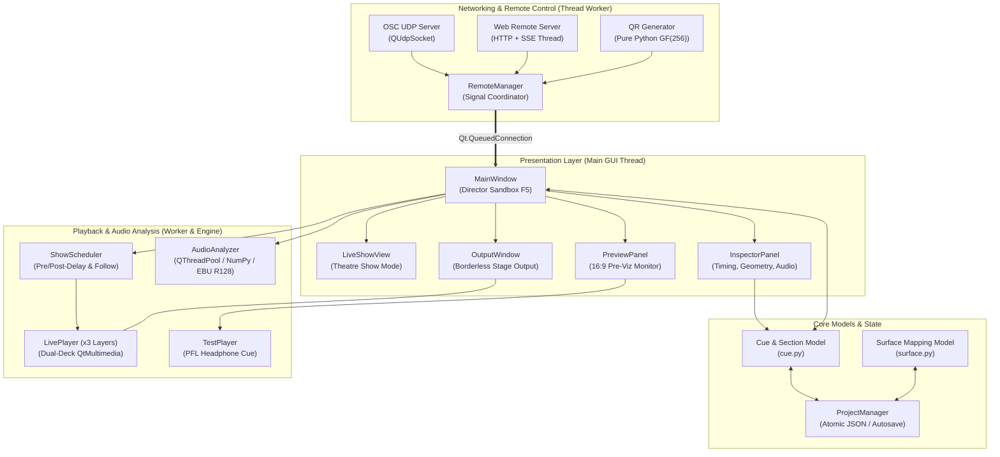
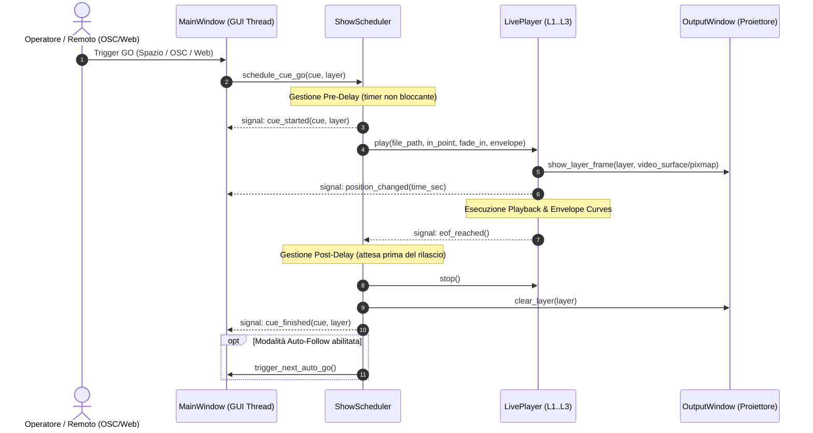

# Architettura del Software e Paper Tecnico — BlindCue

Documentazione tecnica e architetturale rivolta a sviluppatori, integratori e contributori che intendono manutenere, estendere, personalizzare o effettuare il fork del progetto **BlindCue**.

---

## 1. Visione Architetturale d'Insieme

BlindCue adotta un'architettura modulare a strati basata sul modello **Event-Driven / Reactive** garantito dal loop degli eventi di **PySide6 (Qt 6)**. L'applicazione separa nettamente le responsabilità tra:
1. **Core Data Models** (`blindcue/models`): Entità serializzabili in memoria prive di logica di rendering.
2. **Playback Engines** (`blindcue/engine`): Motori multimediali concorrenti operanti in isolamento acustico/visivo.
3. **Background Services** (`blindcue/services`): Server di rete (OSC e Web) disaccoppiati dal thread dell'interfaccia utente.
4. **Presentation Layer** (`blindcue/ui`): Interfacce grafiche per il monitor di regia e per l'uscita a schermo intero borderless per il pubblico.

---

## 2. Flusso dei Dati e Ciclo di Vita di una Cue

Il transito di un comando dall'input operatore (o remoto) all'emissione audio/video segue una sequenza rigorosa per prevenire collisioni e blocchi del thread principale.

### Dettaglio delle Fasi:
1. **Trigger**: L'evento `GO` può provenire da tastiera fisica (`Key_Space`), interfaccia touch (`btn_go`), server UDP OSC (`/go`) o richiesta HTTP REST (`/api/action`).
2. **Schedulazione**: `ShowScheduler` valuta l'eventuale `pre_delay`. Durante questo intervallo lo stato della Cue passa a `PENDING`/`ATTESA` con animazione progressiva del badge in scaletta.
3. **Decodifica e Deck Handoff**: `LivePlayer` prepara il decodificatore hardware. Nel caso di transizioni continue o sezioni virtuali (`A/B/C...`), viene allocato un deck secondario in pre-roll muto per azzerare i tempi morti tra sequenze contigue.
4. **Compositing**: Il frame video (o l'immagine statica) viene inviato al widget di compositing di `OutputWindow`, che applica in sequenza:
   - Posizione, scala e ritaglio (crop);
   - Deformazione quad-corner pin (se la superficie è mappata);
   - Mascheratura vettoriale o canale alfa;
   - Trasparenza d'inviluppo e opacità di livello.
5. **Rilascio e Cascata**: Al raggiungimento del punto di uscita (`out_point` o termine naturale del media), si attiva l'eventuale `post_delay`. Al completamento, il layer viene azzerato e, se il campo `follow_mode` è impostato su `AUTO_FOLLOW` o `SIMULTANEOUS`, viene emesso il segnale per la cue successiva.

---

## 3. Descrizione Dettagliata dei Moduli

### 3.1. Core Data Models (`blindcue/models/`)
- **`cue.py`**:
  - Struttura fondamentale `Cue`: modella tipo media (`VIDEO`, `AUDIO`, `IMAGE`, `GROUP`), layer di destinazione (`1`, `2`, `3`), coordinate di crop, inviluppi audio/video a keyframe, proprietà di loop e sezioni virtuali.
  - Rilevamento collisioni layer (`detect_layer_conflicts`): algoritmo preventivo che analizza la scaletta per evidenziare se due o più cue simultanee competono per il medesimo livello video senza preavviso.
- **`surface.py`**:
  - Modello delle superfici di proiezione (`SurfaceDefinition`): calcola la matrice omografica per il quad-corner mapping (keystone digitale a 4 vertici) e gestisce maschere vettoriali ad anello, rettangolari o forate.
- **`project_manager.py`**:
  - Serializzazione/Deserializzazione in formato JSON (`.blindcue`).
  - Scrittura atomica: scrive i dati su file temporaneo (`tempfile`), invoca il flush del kernel (`os.fsync`) ed esegue la sostituzione atomica (`os.replace`) per garantire l'immunità a crash di alimentazione o chiusure forzate.
  - Protezione anti-path traversal: risolve percorsi relativi isolandoli nell'albero della cartella del progetto show.

### 3.2. Engine e Pipeline Multimediale (`blindcue/engine/`)
- **`player_live.py`**:
  - Gestisce l'emissione dei tre layer di sala tramite istanze `QMediaPlayer` e `QAudioOutput`.
  - Integra la gestione delle sezioni virtuali e l'applicazione in tempo reale delle curve logaritmiche e sigmoidi per dissolvenze audio e video.
- **`player_test.py`**:
  - Riproduttore indipendente utilizzato dalla sandbox di regia per il pre-ascolto isolato in cuffia dell'operatore, senza interferire con il flusso master inviato al pubblico.
- **`audio_analyzer.py`**:
  - Estrazione asincrona dei picchi audio tramite sottoprocesso `ffmpeg` in formato PCM grezzo (`f32le`), convertito in vettori compatti `numpy.ndarray`.
  - Scansione normalizzata secondo standard EBU R128 (LUFS integrato e True Peak dBFS).
  - Elaborazione confinata su `QThreadPool` globale: nessuna operazione I/O blocca l'interfaccia grafica.
- **`device_manager.py`**:
  - Rilevamento a caldo e indirizzamento hardware delle interfacce audio disponibili (`QMediaDevices`). Permette di separare la scheda audio della sala (PA) da quella delle cuffie del tecnico (PFL).
- **`earcon.py`**:
  - Generatore software di toni e segnali acustici di conferma (earcons) per feedback operativo accessibile.

### 3.3. Servizi e Controllo Remoto (`blindcue/services/`)
- **`osc_protocol.py`**:
  - Implementazione autonoma e conforme allo standard binario OSC 1.0 (Open Sound Control) con codifica/decodifica di stringhe allineate a 32 bit, interi big-endian e float IEEE 754. Nessuna libreria esterna C richiesta.
- **`osc_server.py`**:
  - Server UDP non-bloccante operante su `QUdpSocket`. Riceve pacchetti sui binding di rete, verifica l'eventuale autorizzazione e mappa i percorsi OSC sui segnali del coordinator.
- **`web_server.py`**:
  - Server HTTP multi-thread (`_ThreadingHttpServer`) con supporto Server-Sent Events (SSE) per sincronizzazione bidirezionale continua a latenza zero.
  - Implementa rate-limiting, timeout e blocco forzatura PIN con comparazione temporale sicura (`hmac.compare_digest`).
- **`qr_generator.py`**:
  - Generatore di codici QR in puro Python basato su aritmetica dei campi di Galois GF(256) e polinomi di Reed-Solomon. Rende l'applicazione completamente autonoma da utility di sistema terze su Windows, macOS e Linux.

### 3.4. Livello di Presentazione (`blindcue/ui/`)
- **`main_window.py`**:
  - Orchestratore principale delle viste, barra strumenti, menu di sistema e gestione della coda di Undo/Redo fino a 40 passaggi.
- **`output_window.py`**:
  - Finestra senza bordi (`FramelessWindowHint`), pensata per risiedere stabilmente sullo schermo secondario. Renderizza la composizione a tre livelli e il Layer 0 (pattern di allineamento ottico o blackout di sicurezza).
- **`live_show_view.py`**:
  - Schermata di regia per lo spettacolo. Presenta la scaletta con codice cromatico dinamico, lo standby hero-prompter, l'orologio di sistema e il cronometro cumulativo di scena.

---

## 4. Concorrenza, Thread-Safety e Gestione Risorse

1. **Main GUI Thread**:
   - Gestisce la totalità dei widget grafici, gli eventi di rendering (`QPainter`) e la ricezione dei segnali interni.
2. **Worker Threads (Audio & Analisi)**:
   - I task pesanti (`WaveformAnalyzer`, `LoudnessScanner`, `DynamicsOptimizer`) ereditano da `QRunnable` e operano nel pool di sistema `QThreadPool`. La comunicazione verso la UI avviene unicamente tramite emissione di `Signal` con connessioni di tipo `QueuedConnection`.
3. **Network Threads (Web Server)**:
   - I client HTTP operano su thread daemon dedicati. Il bridge verso la GUI converte ogni richiesta di trigger in `Signal` Qt collegati tramite `Qt.ConnectionType.QueuedConnection`, eliminando qualsiasi accesso concorrente diretto agli stati della finestra principale.
4. **Prevenzione Memory Leak e Garbage Collection**:
   - `ShowRuntimeGuard` inibisce le scansioni periodiche del Garbage Collector durante i momenti critici dell'emissione live per scongiurare drop-frame o micro-lag.
   - Tutti i timer interni utilizzano riferimenti espliciti `parent=self` e vengono arrestati all'invocazione di `closeEvent`.

---

## 5. Modularità, Disaccoppiamento e Forking

Per sviluppatori interessati a derivare o semplificare la base di codice:

- **Rimozione / Isolamento del Server Web**:
  - Il sottosistema Web (`services/web_server.py`) è completamente facoltativo. Disabilitando il componente in `remote_manager.py`, l'applicazione opera in modalità locale pura senza aprire socket TCP.
- **Rimozione / Isolamento del Server OSC**:
  - Il modulo `services/osc_server.py` e il relativo protocollo possono essere esclusi senza impattare la scaletta e i motori di riproduzione.
- **Personalizzazione del Motore di Output**:
  - La classe `OutputWindow` espone un'interfaccia standard (`show_layer_frame`, `clear_layer`, `set_blackout`). È possibile rimpiazzare il canvas Qt basato su `QLabel`/`QPainter` con un render engine accelerato in OpenGL/Vulkan senza toccare la logica delle Cue o dello Scheduler.
