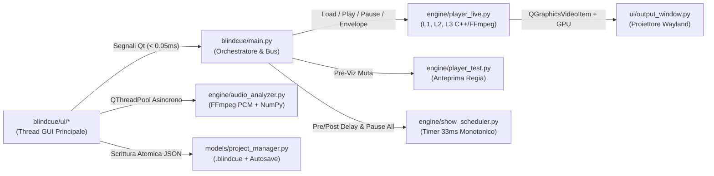

# 🧩 Architettura Interna e Guida ai Moduli di BlindCue

Questo documento descrive **ogni singolo file e cartella del codice sorgente** di BlindCue (`blindcue/`), spiegandone il ruolo, le classi principali, i segnali Qt e come i moduli collaborano tra loro senza bloccare mai la riproduzione Live.

---

## 🧭 Indice Rapido

- [1. Perché i commenti Python non rallentano né destabilizzano il software](#arch-commenti)
- [2. Schema del Flusso Dati & Threading](#arch-flusso)
- [3. Entry Point (`blindcue/main.py`)](#arch-main)
- [4. Livello Dati (`blindcue/models/`)](#arch-models)
- [5. Motore Multimediale e Logica (`blindcue/engine/`)](#arch-engine)
- [6. Interfaccia Utente Modulare (`blindcue/ui/`)](#arch-ui)
- [7. Mappa Completa Dipendenze tra Moduli](#arch-dipendenze)

---

## 💬 1. Perché i commenti Python non rallentano né destabilizzano il software

Una preoccupazione legittima nei software da spettacolo è che aggiungere molti commenti ai file `.py` possa appesantire l'esecuzione o creare problemi durante il Live:

- **Zero impatto a runtime per `# commenti`**: il parser di Python scarta completamente ogni riga di commento `# ...` nel momento in cui compila il file in bytecode (`.pyc`). In memoria ed esecuzione **non esistono** e non consumano nemmeno 1 ciclo di CPU.
- **Impatto nullo per le docstring (`"""..."""`)**: vengono lette una sola volta al caricamento iniziale del modulo e salvate come attributo `__doc__`. Non interferiscono mai con i thread QtMultimedia, FFmpeg, Wayland o coi timer live.
- **Separazione dei piani**: l'elaborazione pesante (decoding video H.264/HEVC, audio PipeWire/ALSA, GPU VA-API/OpenGL) gira in C/C++, mentre Python orchestra soltanto eventi GUI e temporizzazioni con latenze nell'ordine delle decine di microsecondi.

---

## ⚙️ 2. Schema del Flusso Dati & Threading

---

## 🚪 3. Entry Point (`blindcue/main.py`)

| File | Ruolo e Responsabilità |
|------|------------------------|
| [`blindcue/main.py`](../blindcue/main.py) | **Regia centrale dell'applicazione.** Imposta `LC_NUMERIC=C`, gestisce argomenti CLI (`--output-screen`, `--windowed`), rileva gli schermi disponibili (scegliendo fullscreen borderless su proiettore esterno oppure finestra 16:9 su monitor singolo), istanzia `OutputWindow`, `MainWindow`, `TestPlayer`, i 3 `LivePlayer` (`L1..L3`) e `ShowScheduler`. Collega i segnali bidirezionali (`cue_fired`, `panic_requested`, `pause_all_toggled`, `layer_play_pause_requested`, `blackout_requested`, `layer_clear_requested`, `live_automation_updated`), aggiorna in tempo reale opacità immagini e barre live (`elapsed / countdown / PRE / POST`) e gestisce la chiusura sicura su `SIGINT`/`SIGTERM`. |

---

## 🗂️ 4. Livello Dati (`blindcue/models/`)

| File | Classi / Funzioni | Cosa fa |
|------|-------------------|---------|
| [`models/cue.py`](../blindcue/models/cue.py) | `MediaType`, `CueStatus`, `FollowMode`, `GroupMode`, `CueSection`, `Cue` | Definisce la struttura dati di ogni **Cue** e **Gruppo/Scena** (`cue_id`, `q_label`, `name`, `layer`, `scale`, `crop`, `position_x/y`, `opacity`, `aspect_ratio`, `volume`, `fade_in/out`, `fade_curve`, `volume_points`, `opacity_points`, `in_point/out_point`, `loop`, `loop_count`, `hold_time`, `pre_delay`, `post_delay`, `follow_mode`, `color`, `parent_id`, `group_mode`, `collapsed`, `sections`, `notes`), la validazione difensiva (con supporto file_path vuoto per container) e la serializzazione JSON atomica (`to_dict` / `from_dict`). |
| [`models/project_manager.py`](../blindcue/models/project_manager.py) | `ProjectManager` | Gestisce apertura, salvataggio `.blindcue`, autosave periodico in `~/.config/blindcue/autosave.json` e **crash recovery** all'avvio. Usa sempre la **scrittura atomica POSIX** (`tempfile` nella stessa cartella → `fsync` → `os.replace`) in modo che un blackout elettrico durante il salvataggio non corrompa mai lo show. |

---

## ⚡ 5. Motore Multimediale e Logica (`blindcue/engine/`)

| File | Classi / Funzioni | Cosa fa |
|------|-------------------|---------|
| [`engine/device_manager.py`](../blindcue/engine/device_manager.py) | `DeviceManager` | **Gestore centrale uscite e routing di regia.** Monitora dispositivi audio fisici (`QMediaDevices`), schermi collegati (`QGuiApplication.screens`) e profili hardware (`Eco` / `Standard` / `Performance`). Permette di assegnare l'uscita **Master Sala (PA)** a `LivePlayer` e l'uscita **Monitor Cuffia (PFL)** a `TestPlayer` per pre-ascolto isolato. Gestisce hotplug USB senza interruzioni né crash. |
| [`engine/player_live.py`](../blindcue/engine/player_live.py) | `LivePlayer` | Motore audio/video per l'uscita pubblica (1 istanza per Layer `1, 2, 3`). Gestisce il reset completo sorgente (`QUrl()`) per ripartenze pulite, i tagli `IN/OUT`, le rampe di volume/opacità a `20ms` tramite `evaluate_cue_level`, il **pre-caricamento su doppio deck** (`standby_player`) per salti/loop video su sezioni `A/B/C` con micro-stacchi ridotti al minimo, `fade_out` fluido, routing dinamico scheda audio (`set_audio_device`) e `is_playing`/`is_paused`. |
| [`engine/player_test.py`](../blindcue/engine/player_test.py) | `TestPlayer` | Motore isolato per l'anteprima **Pre-Viz / PFL** in cabina regia. Muto di default (`set_mute`), instradabile su dispositivo dedicato (es. Cuffia Regia tramite `set_audio_device`), riproduce le stesse curve di fade, keyframe di volume/opacità e sezioni virtuali del Live per collaudare i brani prima di mandarli in onda. |
| [`engine/audio_analyzer.py`](../blindcue/engine/audio_analyzer.py) | `WaveformAnalyzer` | `QRunnable` eseguito in background su `QThreadPool`. Interroga `ffprobe` e decodifica PCM a `8000 Hz` tramite pipe `ffmpeg` riducendo i picchi con `NumPy` fino a `3200+` campioni per mantenere nitida la forma d'onda anche a zoom `32×` senza congelare la GUI. |
| [`engine/envelope.py`](../blindcue/engine/envelope.py) | `apply_fade_curve`, `evaluate_cue_level`, `SectionSequencer`, `split_sections_at`, `normalize_sections` | Matematica pura (zero dipendenze Qt GUI) per: curve di dissolvenza (`log`, `scurve`, `linear`), interpolazione keyframe `[tempo, livello]`, normalizzazione delle sezioni contigue `A/B/C...`, e state machine `SectionSequencer` che gestisce ripetizioni `x1..∞`, salti diretti e `Break Loop`. |
| [`engine/show_scheduler.py`](../blindcue/engine/show_scheduler.py) | `ScheduledWindow`, `ShowScheduler` | Scheduler monotonico a singolo `QTimer (33ms)` che gestisce tutte le finestre di attesa **`Pre-Delay`** e **`Post-Delay`** sui 3 layer e supporta il congelamento istantaneo tramite **`PAUSA TUTTO`** (`set_paused`) mantenendo il residuo temporale esatto al millisecondo, oltre all'annullamento istantaneo su `Cut` / `Blackout` / `PANIC`. |

---

## 🖥️ 6. Interfaccia Utente Modulare (`blindcue/ui/`)

### Finestre Principali & Uscita Live
| File | Classi / Funzioni | Cosa fa |
|------|-------------------|---------|
| [`ui/main_window.py`](../blindcue/ui/main_window.py) | `MainWindow` | Finestra principale del tecnico. Contiene un `QStackedWidget` per commutare in <1 ms tra la **Vista Progetto** (i 6 pannelli configurabili con splitter bloccabili) e la **Modalità LIVE (`LiveShowPanel`)**. Coordina selezione singola/multipla, catene `SIMULTANEOUS`, blocchi di sicurezza tasti in Live Mode, `LIVE MIRROR`, Undo/Redo e salvataggi. |
| [`ui/output_window.py`](../blindcue/ui/output_window.py) | `OutputWindow` | Finestra proiettore Wayland basata su `QGraphicsScene`. Compone `Layer 0` (Tappo) sotto i livelli indipendenti `Layer 1, 2, 3` (immagini scalate/croppate e `QGraphicsVideoItem` primari + secondari per doppio deck video). Gestisce `show_mirrored_frame` per l'anteprima Mirror dei video in Standby, `show_fallback` (`0.2s` fade) e **`panic_blackout`** (`0ms` su Nero puro `#000000` o Tappo custom). |
| [`ui/tappo_pattern.py`](../blindcue/ui/tappo_pattern.py) | `is_default_tappo_path`, `render_default_tappo_pixmap` | Genera dinamicamente un pattern vettoriale di **calibrazione proiettore** ad alta precisione attorno al logo **BlindCue**: bordi perimetrali cyan a filo `0px`, tacche `10%`, area `90% Safe`, squadre d'angolo ambra/verdi, griglia `16×9`, cerchi concentrici anti-keystone ed etichette `ALTO/BASSO/SX/DX`. |

### Componenti Modalità Progetto & LIVE
| File | Classi / Funzioni | Cosa fa |
|------|-------------------|---------|
| [`ui/live_show_view.py`](../blindcue/ui/live_show_view.py) | `LiveShowPanel`, `LiveCueRowDelegate`, `format_cue_timing_summary` | Schermata dedicata allo spettacolo **Modalità LIVE**: barra superiore simmetrica con ritorno a Progetto, orologio di sistema centrato, **Cronometro Spettacolo (`⏱` con avvio automatico al 1° `GO`, pausa/ripresa manuale con clic e reset `↺`)** e tasto **`🚨 PANIC [ESC]`** lontano dal trasporto; tabella estesa a 6 colonne di sola lettura con supporto completo ai **Gruppi/Scene** (collasso/espansione `▶`/`▼`, indentazione ad albero `├── `/`└── `, riepilogo modalità e conteggio figli); banner Standby con `Esci da Loop Sezione`; monitor `L3→L1`; **`⏸ PAUSA TUTTO` / `▶ RIPRENDI`** e hero **`GO [SPAZIO]`**. |
| [`ui/cue_list_panel.py`](../blindcue/ui/cue_list_panel.py) | `CueListPanel` | Pannello sinistro della Scaletta in modalità Progetto: include intestazione con stato Standby + tasto **`🎭 VAI IN LIVE`**, tabella `CueSequenceTable`, bottoni aggiunta media (`+ Video`, `+ Audio`, `+ Foto`, **`+ Gruppo`**), riordino/eliminazione e barra a 3 modalità (**`⏹ Blocco` / `⤵ Auto-GO` / `⇉ Simult.`**) con suggerimenti contestuali live on-hover e tooltip. |
| [`ui/cue_table.py`](../blindcue/ui/cue_table.py) | `CueSequenceTable`, `CueTableDelegate`, `paint_cue_row_decorations` | Tabella a 3 colonne (`#`, `Q`, `Nome / Media`) con editing inline `[F2]`, selezione estesa (`Ctrl`/`Shift`), gestione **Gruppi Scena (collasso/espansione a riga singola con `setRowHidden` a 60fps, indentazione grafica ad albero `├── `/`└── `, badge pillola `GRP` e conteggio figli)**, menu contestuale Colore Scena/Gruppo (`cue.color`), fascia laterale + divisori di capitolo e binario grafico sinistro di concatenazione. |
| [`ui/inspector_panel.py`](../blindcue/ui/inspector_panel.py) | `CueInspectorPanel` | Pannello destro **a schede (linguette)** con box modificabili ben in evidenza e guide contestuali: **`🎯 Cue · Tempi`** (`Q`, Nome, Note, **Colori Gruppo**, Layer `L1-L3`, `Pre-Delay`, `Post-Delay`), **`🖼 Video · Foto`**, **`🎵 Audio · Tagli`**, e la scheda dinamica **`📁 Gruppo · Scena`** (identità gruppo, tempi Pre/Post-Wait scena, 5 modalità al GO `Simultaneo`/`Sequenziale`/`Passo-Passo`/`Random`/`Loop`, lista membri con durata totale e rimozione rapida `✕` o scioglimento `Ungroup`). |
| [`ui/preview_panel.py`](../blindcue/ui/preview_panel.py) | `PreviewControlPanel` | Contenitore superiore centrale della Pre-Viz: badge `PRE-VIZ`, switch **`LIVE MIRROR`**, readout file e orologio trascorso/totale, aspect ratio live, comandi `▶ Play` / `⏸ Pausa` / `■ Stop` e pulsante di sicurezza **`MUTE: ON/OFF`**. |
| [`ui/preview_monitor.py`](../blindcue/ui/preview_monitor.py) | `StudioPreviewMonitor` | Canvas 16:9 WYSIWYG che renderizza Tappo L0, frame `QVideoSink` o immagini statiche con clipping rigoroso al 16:9. Offre trascinamento diretto di posizione, **8 maniglie per ritaglio visuale live**, barre equalizzatore audio in ascolto ed emette `video_frame_changed` per il Live Mirror dei video in Standby. |
| [`ui/waveform_widget.py`](../blindcue/ui/waveform_widget.py) | `WaveformPanel`, `WaveformWidget` | Timeline interattiva inferiore sinistra: visualizza picchi forma d'onda con **zoom orizzontale (`1.0×`–`32.0×`)** + `zoom_scroll` + righello temporale, testina di lettura (`PRE-VIZ`/`LIVE`), snap `IN/OUT a Testina`, reset `IN/OUT`, pallini trascinabili Fade In/Out (`Log`, `S-Curve`, `Linear`), **inviluppo grafico orizzontale Volume / Opacità** (doppio clic per aggiungere nodi, clic destro per eliminare), orizzonte virtuale per Immagini infinite e comandi di taglio Sezioni. |
| [`ui/section_bar.py`](../blindcue/ui/section_bar.py) | `SectionControlBar`, `_SectionCell` | Barra proporzionale agganciata sotto la forma d'onda (allineata pixel per pixel allo zoom/pan corrente): mostra i blocchi colorati `A, B, C...` con menu a tendina per ripetizioni (`x1..x8`, `∞`, `Salta`) e salto diretto con clic sul badge lettera. |
| [`ui/live_status_panel.py`](../blindcue/ui/live_status_panel.py) | `LiveStatusPanel`, `_LiveLayerBar` | Monitor in tempo reale dei 3 layer disposti dall'alto in basso nell'ordine di sovrapposizione (**`L3 → L2 → L1`**): barra progressiva con trascorso a sinistra, titolo centrato e countdown `-MM:SS` a destra (ambra `<12s`, rosso `<5s`, `∞` loop), tasto circolare **`⏸/▶`** per prove Audio/Video e `✕ Cut`. Gestisce anche le modalità visive `PRE` (cyan) e `POST` (viola) e i controlli `Blackout` / `Tappo L0`. |

### Utilità e Componenti Condivisi UI
| File | Classi / Funzioni | Cosa fa |
|------|-------------------|---------|
| [`ui/layout_math.py`](../blindcue/ui/layout_math.py) | `compute_media_frame_geometry`, `parse_aspect_ratio`, `MediaFrameGeometry` | Unica fonte matematica condivisa fra `StudioPreviewMonitor` e `OutputWindow` per garantire che scala, offset, aspect ratio e **ritaglio ancorato ai bordi** risultino identici al pixel su qualsiasi monitor o proiettore. |
| [`ui/undo_manager.py`](../blindcue/ui/undo_manager.py) | `UndoManager` | Cronologia leggera ad anello (`40` snapshot JSON in RAM) con debounce a `450ms` su slider/spinbox: annulla o ripristina modifiche senza mai toccare o interrompere le cue attualmente in `LIVE`. |
| [`ui/spinboxes.py`](../blindcue/ui/spinboxes.py) | `SmartDoubleSpinBox`, `InPointSpinBox`, `OutPointSpinBox` | Spinbox decimali tolleranti a punto `.` e virgola `,`, con pulsanti vettoriali `+` / `-` ad alto contrasto e logica intelligente per scalare indietro da *"Fine File"* al punto `OUT`. |
| [`ui/drop_zone.py`](../blindcue/ui/drop_zone.py) | `DropZone` | Area tratteggiata per importare al volo uno o più file multimediali via Drag & Drop dal file manager di sistema. |
| [`ui/device_settings_dialog.py`](../blindcue/ui/device_settings_dialog.py) | `DeviceSettingsDialog` | Finestra modale per la gestione rapida di: profilo hardware (Auto / Eco muletto <=4GB / Performance), assegnazione Master Audio Sala (PA), Monitor Cuffia Regia (PFL) e selezione schermo video di proiezione. |
| [`ui/hardware_info.py`](../blindcue/ui/hardware_info.py) | `detect_hardware_brief`, `show_hardware_info_dialog`, `show_about_dialog`, `get_memory_details`, `evaluate_hardware_profile`, `ShowRuntimeGuard` | Ispeziona `/proc/cpuinfo`, `/proc/meminfo`, `lspci`, `/dev/dri/renderD128` e sessione Wayland. Include `ShowRuntimeGuard` che disattiva o posticipa il Garbage Collector Python durante la Modalità LIVE e adatta il pool di thread hardware alle capacità della macchina. |
| [`ui/theme.py`](../blindcue/ui/theme.py) | `DARK_STYLESHEET`, costanti colore & estensioni | Palette *Pro Broadcast Obsidian Slate*, foglio di stile unificato Qt6, percorso logo di default ed insiemi delle estensioni video/audio/immagine riconosciute. |

---

## 🔗 7. Mappa Completa Dipendenze tra Moduli

- **Nessun riferimento circolare tra GUI e Motore**: `models/` non importa nulla da `ui/` o `engine/`; `engine/envelope.py` non importa nulla da Qt GUI (`PySide6.QtWidgets`); solo `blindcue/main.py` connette insieme `MainWindow`, `OutputWindow`, `LivePlayer`, `TestPlayer` e `ShowScheduler`.
- **Single Source of Truth geometrica**: tutte le trasformazioni visive di Anteprima, Mirroring ed Uscita Proiettore convergono su [`compute_media_frame_geometry`](../blindcue/ui/layout_math.py).
- **Single Source of Truth di inviluppo**: curve Fade In/Out, nodi Volume/Opacità e sequenze `A/B/C` convergono su [`evaluate_cue_level`](../blindcue/engine/envelope.py) e [`SectionSequencer`](../blindcue/engine/envelope.py) sia in Pre-Viz (`TestPlayer`) che sul palco (`LivePlayer` + timer immagini in `main.py`).
