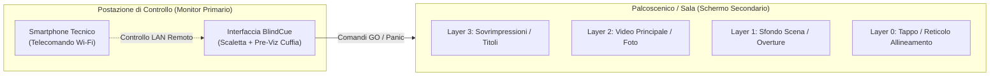
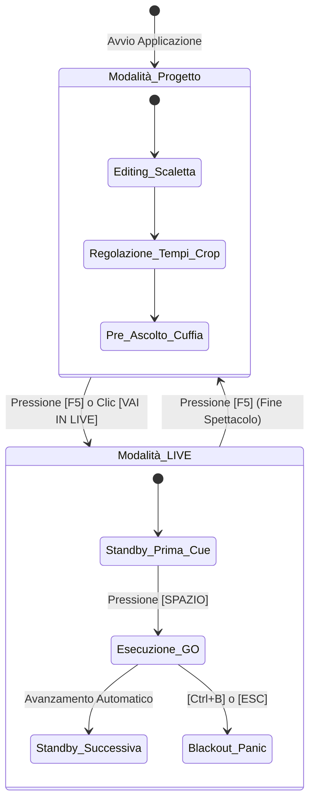
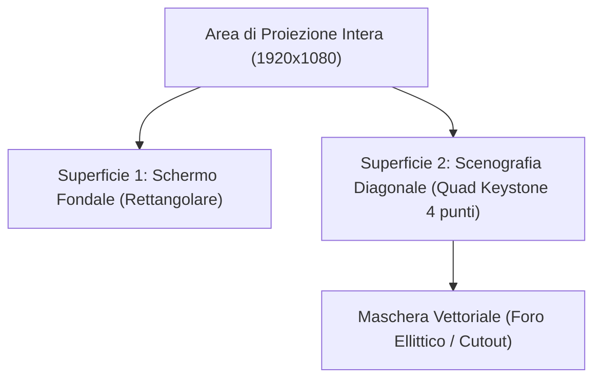
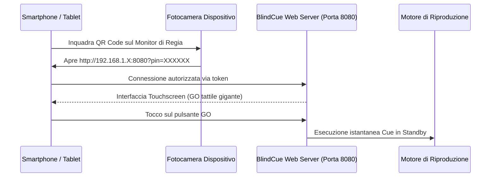

# Manuale Utente Operativo — BlindCue

Guida operativa passo-passo per tecnici di regia, direttori di scena e operatori teatrali.

---

## 📌 Indice Cliccabile

1. [Concetti Fondamentali e Architettura di Scena](#1-concetti-fondamentali)
2. [Configurazione della Doppia Uscita Video (Regia vs Sala)](#2-doppia-uscita-video)
3. [Guida alle Due Modalità: Progetto e LIVE](#3-modalita-operative)
4. [Logica e Tipologie di Cue](#4-logica-cue)
   - 4.1 [Media Supportati (Video, Audio, Immagini)](#41-media-supportati)
   - 4.2 [Gruppi e Scene Collettive](#42-gruppi-scene)
   - 4.3 [Modalità di Avanzamento (Blocco, Auto-GO, Simultanea)](#43-modalita-avanzamento)
   - 4.4 [Tempi di Attesa (Pre-Delay, Durata, Post-Delay)](#44-tempi-attesa)
5. [Controlli Audio, Routing e Monitoraggio](#5-controlli-audio)
6. [Mappatura Superfici, Warping e Maschere](#6-superfici-mapping)
7. [Controllo Remoto (Web Mobile e Automazione OSC)](#7-controllo-remoto)
8. [Procedure di Emergenza e Gestione Imprevisti](#8-emergenza-panic)
9. [Risoluzione dei Problemi Comuni (Troubleshooting)](#9-troubleshooting)

---

<a id="1-concetti-fondamentali"></a>
## 1. Concetti Fondamentali e Architettura di Scena

BlindCue nasce per risolvere il problema principale della videoproiezione e della diffusione sonora negli spettacoli dal vivo: **il pubblico in sala non deve mai assistere a manovre tecniche dell'operatore, finestre del sistema operativo o arresti improvvisi**.

L'architettura separa completamente due ambienti:
- **Monitor 1 (Regia / Operatore)**: Interfaccia di programmazione o visualizzazione LIVE ad alto contrasto.
- **Monitor 2 / Proiettore (Sala / Pubblico)**: Finestra a tutto schermo priva di cornici (`OutputWindow`), che renderizza esclusivamente i contenuti mandati in onda.



---

<a id="2-doppia-uscita-video"></a>
## 2. Configurazione della Doppia Uscita Video (Regia vs Sala)

All'avvio del sistema, collegare il cavo del proiettore (HDMI, DisplayPort o SDI) prima di lanciare BlindCue.

1. **Impostazione del Display nel Sistema Operativo**:
   - Accertarsi che il display esterno sia configurato in modalità **"Estendi Schermo"** (Desktop Esteso), **mai in modalità "Duplica / Mirroring"**.
2. **Assegnazione Automatica in BlindCue**:
   - BlindCue rileva gli schermi disponibili. Se è presente più di un monitor, la finestra di output si ancora automaticamente allo schermo secondario (Display 1).
3. **Selezione Manuale dello Schermo di Uscita**:
   - Dalla barra del menu di BlindCue, aprire **`Strumenti` → `Dispositivi e Uscite...`** (o premere **`F2`**).
   - Nel riquadro **Display Secondario di Uscita**, selezionare il dispositivo desiderato e confermare con **`Applica`**.
4. **Calibrazione Ottica con il Layer 0**:
   - Quando nessun video o immagine è in onda, il proiettore visualizza il **Layer 0 (Failsafe)**.
   - Per impostazione predefinita viene mostrato un reticolo tecnico utile a regolare messa a fuoco, keystone ottico e centratura del fascio luminoso. In qualsiasi momento è possibile caricare un'immagine di blackout totale (tessuto nero o logo di teatro).

---

<a id="3-modalita-operative"></a>
## 3. Guida alle Due Modalità: Progetto e LIVE

BlindCue dispone di due modalità operative distinte, commutabili tramite **`F5`** oppure con il pulsante in cima alla scaletta:



### 3.1. Modalità Progetto (Programmazione)
- Consente l'inserimento, spostamento e cancellazione di file audio, video e immagini tramite drag-and-drop.
- Tutti i pannelli (Scaletta, Pre-Viz 16:9, Ispettore, Automazioni Waveform) sono modificabili e possono essere bloccati tramite l'icona del lucchetto (`🔒`).
- L'ascolto effettuato nel monitor centrale **Pre-Viz** è confinato alle sole cuffie del tecnico (PFL).

### 3.2. Modalità LIVE (Show Mode)
- Pensata per la conduzione in diretta senza distrazioni.
- La scaletta viene estesa a tutto schermo con font ad alto contrasto.
- **I tasti di modifica distruttiva (`Canc`, `F2`, cancellazione drag-and-drop) vengono disabilitati** per scongiurare errori accidentali durante la rappresentazione.
- Attiva l'orologio di sistema e il **Cronometro Cumulativo (`⏱`)** della replica.

---

<a id="4-logica-cue"></a>
## 4. Logica e Tipologie di Cue

Ogni elemento in scaletta è una **Cue** dotata di identificatore (`Q`), nome, note di scena, tempi di attesa e parametri di riproduzione.

### 4.1. Media Supportati
- **Video (`VID`)**: File multimediali riprodotti con accelerazione hardware. Supportano ritaglio (crop), regolazione opacità da 0 a 100%, posizionamento continuo su assi X/Y e sezioni virtuali.
- **Audio (`AUD`)**: File sonori mono/stereo/multicanale con dissolvenze d'ingresso/uscita parametriche e profilazione d'inviluppo volumetrico a keyframe.
- **Immagini (`IMG`)**: Grafiche statiche (locandine, sfondi, cartelli, texture scenografiche) a durata temporizzata o permanente con fade-in e fade-out.
- **Gruppi (`GRP`)**: Contenitori gerarchici multi-traccia.

### 4.2. Gruppi e Scene Collettive
Selezionando più cue e premendo **`Ctrl+G`**, esse vengono raggruppate in una scena. Dalla scheda dell'Ispettore è possibile scegliere la modalità del gruppo:
1. **Simultaneo (`⇉`)**: Al comando GO, tutti gli elementi interni si avviano nello stesso istante.
2. **Sequenziale (`⤵`)**: Gli elementi si concatenano uno dopo l'altro rispettando le durate.
3. **Passo-Passo (`⏹`)**: Ogni pressione del tasto GO fa avanzare la scena di un elemento interno.
4. **Random (`🎲`)**: Riproduzione casuale di uno degli elementi interni (anti-ripetizione).
5. **Loop Scena (`🔁`)**: Ripetizione ciclica continua di tutti i media interni al gruppo.

### 4.3. Modalità di Avanzamento
Accanto a ciascuna cue è presente un selettore di sequenza a tre stati:
- **`⏹ MANUALE / BLOCCO`**: La cue viene eseguita e il cursore si ferma sulla successiva in Standby. Richiede un nuovo comando GO esplicito.
- **`⤵ AUTO-GO`**: Al termine della cue (Pre-Delay + Durata + Post-Delay), la successiva parte in automatico.
- **`⇉ SIMULTANEA`**: La cue avvia contestualmente anche la riga sottostante.

### 4.4. Tempi di Attesa (Pre-Delay, Durata, Post-Delay)
```text
[ Comando GO ]
      │
      ▼
┌──────────────┐      ┌─────────────────────────┐      ┌──────────────┐
│  Pre-Delay   │ ───► │  Riproduzione Attiva    │ ───► │  Post-Delay  │ ───► Rilascio Layer
│  (Es. 2.0s)  │      │  (Durata media/video)   │      │  (Es. 1.0s)  │      (o Auto-GO)
└──────────────┘      └─────────────────────────┘      └──────────────┘
```

---

<a id="5-controlli-audio"></a>
## 5. Controlli Audio, Routing e Monitoraggio

1. **Separazione Sala (Master) e Cuffia (PFL)**:
   - Nel pannello `Dispositivi e Uscite`, assegnare il driver principale (es. scheda audio multicanale o uscita HDMI) su **Master Sala** e l'uscita cuffie su **Pre-ascolto PFL**.
2. **Dissolvenze Parametriche**:
   - I valori di `Fade In` e `Fade Out` possono essere inseriti numericamente (in secondi, es. `1.5s`) o trascinati direttamente sulla forma d'onda.
3. **Analisi e Normalizzazione del Volume**:
   - Tramite tasto destro sulla cue sonoro → `Analizza Loudness (EBU R128)`: il software calcola il valore di LUFS integrato e propone un guadagno di compensazione per livellare l'emissione tra tracce registrate a volumi differenti.

---

<a id="6-superfici-mapping"></a>
## 6. Mappatura Superfici, Warping e Maschere

Aprendo lo studio di mappatura con il tasto **`F7`** (`Strumenti` → `Superfici di Proiezione & Video Mapping`):



- **Keystone Digitale a 4 Punti**: Trascinare i quattro vertici della superficie per deformare l'immagine e adattarla a superfici scenografiche inclinate, vele o pareti asimmetriche.
- **Maschere Sagomate**: Possibilità di escludere parti della proiezione (es. per evitare di proiettare sul viso degli attori o per ritagliare aperture di scena).
- **Reticolo Live**: Attivando la spunta `Mostra Guide sul Proiettore`, il reticolo numerato viene inviato sul palco per consentire l'allineamento fisico delle ottiche.

---

<a id="7-controllo-remoto"></a>
## 7. Controllo Remoto (Web Mobile e Automazione OSC)

Per consentire il comando dal palco o dalla platea senza fili:



1. **Attivazione del Servizio**:
   - Aprire la finestra con **`Ctrl+R`** (`Controllo Remoto LAN`).
   - Cliccare sul pulsante in alto **`🔴 SERVIZI REMOTI: OFF (Avvia)`** per portarlo su **`🟢 ATTIVI`**.
2. **Connessione Smartphone Operatore**:
   - Inquadrare il codice QR mostrato nella scheda `Telecomando Operatore`. Il link autentica automaticamente il browser dello smartphone con il PIN dinamico di sicurezza.
   - Lo schermo del telefono mostrerà il pulsante GO ad alta risposta tattile con vibrazione aptica.
3. **Monitor Regista Passivo (Sola Lettura)**:
   - Dalla seconda scheda, condividere il link `/monitor` o far inquadrare il secondo QR Code al regista o al direttore di scena. Questa interfaccia mostra la scaletta e i layer in tempo reale ma **non possiede tasti interattivi**, garantendo l'impossibilità di errori da remoto.
4. **Automazione OSC (Open Sound Control)**:
   - Il software ascolta sulla porta UDP `53000` (personalizzabile). Comandi supportati:
     - `/go` o `/cue/go`: Esegue il GO sullo standby corrente.
     - `/panic`: Arresto immediato a 0ms.
     - `/stop` o `/blackout`: Transizione al nero di sicurezza.
     - `/pause` o `/resume`: Sospensione o ripresa della riproduzione.
     - `/cue/<id>/go`: Lancio diretto della cue specificata.

---

<a id="8-emergenza-panic"></a>
## 8. Procedure di Emergenza e Gestione Imprevisti

In caso di imprevisti o emergenze sul palco durante la replica:

| Situazione | Azione da Compiere | Effetto sul Palco |
|---|---|---|
| **Battuta recitata troppo presto** | Premere subito **`SPAZIO`** | La cue in Standby parte immediatamente. |
| **Attore dimentica battuta / pausa imprevista** | Premere **`PAUSA TUTTO`** in alto | Congela frame video e suono mantenendo l'emissione pronta alla ripresa. |
| **Scena finita in anticipo (Buio concordato)** | Premere **`Ctrl + B`** (`Blackout`) | Dissolvenza morbida di 0.2s su tutti i livelli verso il nero di sicurezza. |
| **Emergenza scenica o guasto (Stop immediato)** | Premere il tasto **`ESC`** (`PANIC`) | **Taglio a 0ms**: spegne istantaneamente audio e video tornando a nero assoluto. |

---

<a id="9-troubleshooting"></a>
## 9. Risoluzione dei Problemi Comuni (Troubleshooting)

### 1. Il proiettore mostra il desktop del computer invece della finestra nera di BlindCue
- **Causa**: Il sistema operativo è impostato su "Schermo duplicato" oppure la finestra di output non è stata assegnata al monitor secondario.
- **Soluzione**: Nelle impostazioni video del sistema operativo, impostare "Estendi lo schermo". In BlindCue, aprire `Strumenti` → `Dispositivi e Uscite` e selezionare `Display 1 (Secondario)` come schermo di destinazione.

### 2. Una cue multimediale compare in colore rosso con la scritta "OFFLINE"
- **Causa**: Il file sorgente (video o audio) è stato spostato, rinominato o risiede su una chiavetta USB scollegata.
- **Soluzione**: Ricollegare la memoria esterna o selezionare la cue nell'Ispettore e cliccare su `Sfoglia...` per aggiornare il percorso del media.

### 3. I dispositivi mobili non si collegano al telecomando Web o non caricano la pagina
- **Causa**: Lo smartphone e il computer di regia sono collegati a due reti Wi-Fi differenti, oppure il firewall locale blocca la porta 8080.
- **Soluzione**: Verificare che entrambi i dispositivi siano agganciati alla medesima LAN di teatro. Nel firewall di sistema, abilitare il traffico in ingresso per la porta TCP `8080` e la porta UDP `53000`.

### 4. L'audio della sala non si sente mentre in cuffia funziona
- **Causa**: Il canale di uscita della cue o la scheda audio master sono disattivati.
- **Soluzione**: Verificare il volume generale nella barra inferiore di BlindCue. Controllare in `Dispositivi e Uscite` che il dispositivo Master Sala corrisponda all'effettiva interfaccia collegata al mixer di sala.

